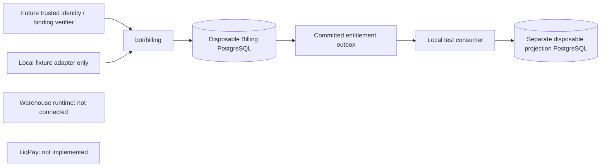

# CarPot Billing foundation v1

Status: implemented local fixture foundation, 2026-11-12. Base: Warehouse PR #518,
`160ffbeef61d80b174a82dca1bebef90c7f2e033`. No runtime registration or deployment.

## Boundaries

`bot/billing/` is an independent module, not a new microservice. It uses the existing
psycopg2 dependency through an explicit synchronous transaction boundary. A future
FastAPI integration must run blocking calls in a worker thread, not the event loop.
No imports from legacy configuration, payment handlers, database pool or startup.
No modifications to Warehouse, main, seller subscriptions, stock or import-worker.

Billing account is the payer. Company workspace subscription is linked through a
verified binding. A principal may belong to multiple accounts; company money and
personal bonuses are different accounts. Never merge identities by email, phone or
username. `Actor` and `VerifiedBinding` are trusted server-side inputs, not HTTP
request DTOs. Phase 1 supplies fixture provisioning only. Real identity verification,
company ownership transfer and principal lifecycle remain integration blockers.

Membership permissions are read from PostgreSQL and intersected with trusted actor
permissions. Finance permissions are independent from Warehouse inventory roles.
Bindings and financial evidence are immutable. Same company scope is also enforced
with composite foreign keys. No foreign keys cross databases.

## Storage and transactions

Only explicit loopback `carpot_billing_*_test` DSNs are accepted. There is no fallback
to DATABASE_URL or Railway variables. Ambient libpq routing options are refused.
Connection hostaddr is forced to loopback; connections close explicitly. This is
intentionally not a production connection policy. Production placement is undecided;
the offline Railway production observed during audit is not selected as authority.

`001_foundation.sql` creates only the new `billing` schema. It is invoked explicitly,
not by legacy migrations_runner or Warehouse Alembic. Migration version and advisory
lock make repeated upgrade safe. `001_projection.sql` creates a separate consumer
schema in a second disposable DB. No financial journal is copied to the consumer.

Models: accounts, memberships, bindings, plan_versions, subscriptions, periods,
invoices, invoice_lines, intents, attempts, webhook_inbox, journal_transactions,
journal_entries, settlements, outbox. This is a foundation, not a complete wallet.

Money uses bigint integer kopecks. `catalogue.quote` uses Decimal, exact UTC duration
ratios and ROUND_HALF_UP once at the quote total. It supports base/add-on quotes;
invoice orchestration currently purchases one pinned base-plan version per period.
Base invoices require exactly one UTC calendar month, including month-end clipping;
callers cannot purchase an arbitrary access horizon for one monthly price.
Prorated upgrade/add-on settlement, wallet, revenue recognition and refunds are later
packages. Prices and issued invoice terms cannot be changed retroactively.

Invoice: draft -> open -> paid; draft/open -> void. Voiding an invoice with an intent
is refused until a future provider cancellation/reconciliation contract exists.
Invoice request keys include a canonical request hash. Same key/different terms is
a conflict. Billing periods cannot overlap through the service's subscription lock.
No public endpoint permits marking an invoice paid.

Fixture success acquires an invoice lock and atomically commits inbox evidence,
attempt confirmation, settlement, balanced journal, invoice state, subscription
version and outbox snapshot. Provider transaction and invoice settlement are unique.
Repeated events are deduplicated; different content under the same ID is a conflict.
Pending/failure after success never revokes money or entitlements. A distinct second
payment for an already settled invoice requires reconciliation; it is not a new period.

Journal signs: debit provider_clearing is positive, credit service_obligation negative.
This records a fixture-funded service obligation, not final accounting recognition of
revenue. Deferred DB constraints reject empty/unbalanced journals. Row update/delete
and truncate are prohibited, and entries cannot be appended to a previously committed
journal. Reversals will be separate transactions in a later package, never history edits.

## Delivery and crash recovery

Outbox payload is immutable; only first delivery acknowledgement can be recorded.
Consumer commits before finance ack. A crash before settlement commit rolls everything
back. A crash after payment commit leaves a durable outbox event. A crash after
consumer commit causes replay, handled by consumer inbox deduplication. Delivery may
be duplicated across workers; correctness does not require exactly-once transport.

Snapshot versions are monotonic per subscription. They contain all paid intervals,
not merely the most recently processed payment: late settlement of an older period
cannot shorten access. Consumers reject mismatched local bindings, conflicting same
versions, unsupported schemas and any real-service activation flag. Gaps between
paid intervals remain gaps. Consumers must check intervals against current time.

All fixture snapshots have `environment=test` and `activates_real_services=false`.
The test projection is not read by Warehouse. No mock event activates real services.
Production events will require authenticated service transport, tenant authorization,
version negotiation, replay/reconciliation runbooks and independent security review.

## Release and rollback

All flags default false. No background dispatcher, HTTP router or startup hook is
registered. Runtime dependency manifests are unchanged. Additive local migrations
are not permission to run them in staging or production.

Rollback is disable new routing/collections and preserve all financial evidence.
`Database.rollback()` refuses destructive downgrade. Keep processing already accepted
operations when a real provider is introduced. Never DROP/TRUNCATE financial history
as an operational rollback. Test fixture schema reset applies only to disposable DBs.
