# Phase 2 — Warehouse entitlements, capacity and trial

Base: Phase 1 `6cc2ee9d76bbb766371cae8fcc3adb169940b79c`, stacked on PR #520.
This package is an isolated product-policy pilot, not production Billing or LiqPay.

## Architecture

```mermaid
flowchart LR
    Owner[Warehouse server-authenticated owner] --> Proof[60-second signed binding proof]
    Proof --> Billing[Shared bot/billing module]
    Billing --> Finance[(Disposable finance PostgreSQL)]
    Finance --> Events[Versioned full temporal snapshot / durable outbox]
    Events --> Auth[Issuer + audience + scope + expiry + replay verification]
    Auth --> Warehouse[(Separate Warehouse PostgreSQL)]
    Warehouse --> Policy[RBAC ∩ workspace ∩ entitlement ∩ operation]
    Policy --> Quota[Workspace lock + atomic quota/provenance guards]
```

Finance owns account binding and trial claim; Warehouse owns only product projections,
usage and inventory. No second payment ledger, wallet or provider integration is added.
The existing Phase 1 v1 consumer remains intact. v2 snapshots contain per-interval
plan/capacity/seats and effective_from/effective_until, so future changes cannot rewrite
current or historical limits. Base/trial windows may not overlap; add-ons expire separately.

## Default OFF and compatibility

`WAREHOUSE_ENTITLEMENTS_ENABLED` defaults OFF. Even when explicitly set true, execution
requires a loopback Warehouse database ending `_test`. No production/staging activation
path is supplied. Binding defaults to compatibility; registration does not bind, trial,
enroll or create debt automatically. Only explicit local trusted enrollment selects
compatibility / dry_run / enforce per workspace. Existing subscriptions and dismantling
credits are neither converted nor read as garage capacity. Legacy LiqPay routing remains
unchanged. Existing legacy billing preparation remains separate and disabled.

Local pilot controls: `python -m app.entitlements_admin WORKSPACE --mode dry_run` then
`--mode enforce`, after owner binding. These reject non-local/non-test DBs. Dry-run
reports current donor/team usage, over-limit and operations that would be blocked.
Rollback selects compatibility or disables the flag; inventory/history is preserved.

## Binding and transport

Owner proof is derived only from Warehouse Identity: DIRECTOR and actor_id equal to the
server-derived workspace. No frontend workspace_id, roles, email/phone or username is
accepted as ownership evidence. A shared local random test key (minimum 32 bytes) signs
canonical HMAC-SHA256 envelopes. Verify issuer, audience, exact scope, iat/exp (max 60s),
environment=test and jti. Finance consumes binding jti; Warehouse consumes delivery jti
and durable event ID/hash. Same event may be safely replayed in a new authenticated
envelope. Older versions cannot replace a newer projection. Same-version conflicts fail.

Local-only configuration additionally requires `WAREHOUSE_ENTITLEMENT_TEST_KEY` and an
explicit Phase 1 guarded `CARPOT_BILLING_TEST_DSN`. Keys in tests are synthetic. There is
no public webhook or general entitlement-write endpoint. Trial/sync are owner-only and
use trusted internal adapters. A finance commit followed by delivery failure is recovered
by `/billing/sync`, without another trial period. Production identity issuer, asymmetric
key management/service auth, approved financial DB placement and ownership-transfer flow
remain BLOCKED external integration decisions.

One trial claim is enforced per verified billing company account and workspace binding.
It does not prove one real legal company globally: multiple Warehouse registrations can
still represent the same real company. Do not claim duplicate-company abuse is solved
without stronger verified organization identity. No email-based merging is performed.

## APIs

All require current Warehouse session; mutations require CSRF and existing RBAC.

| Route under /api/v1/billing | Contract |
|---|---|
| GET /entitlements | current status/time bounds, usage, limits, over-limit, mode, would_block; staff data redacted |
| POST /bind | no client ownership fields; derive owner/workspace on server |
| POST /trial | `{plan: standard|premium}`; one 10-day claim, plan switch keeps deadline |
| POST /sync | recover latest central snapshot; no new grant/payment |
| POST /quote | `{pack: pack_1|pack_5|pack_10}`; integer kopecks prorated to current end; checkout false |
| POST /returns | `{sale_id,quantity,request_key}`; requires inventory.adjust_quantity + sales.create; real prior stock sale only |

Checkout/callback/cancel-renewal remain 503. HTTP 402 means new operation needs paid
access; 409 covers quota, archive/provenance, duplicate trial and event conflicts;
403 covers ownership/permissions; 422 covers invalid/impersonating DTOs.

## Migrations and evidence

- `a12b34c56d78` after `08b72c9d4e16`: Warehouse projection, authenticated receipts,
  immutable donor provenance and verified-return records. No inventory backfill or
  enrollment happens during migration. Empty-only downgrade; recorded evidence refuses
  downgrade. Existing forward-only Warehouse migration guards remain unchanged.
- Explicit local finance `bot.billing.phase2.migrate`: `002_reconciliation.sql` replaces
  the invoice-period uniqueness rule with one non-void invoice per period, preserving
  void invoices/lines; adds immutable reconciliation cases and persisted calendar anchor.
- Local bridge bootstrap creates central binding/trial/outbox/transport receipts inside
  the same `billing` schema, explicitly and only through guarded fixture storage.

Full file list, acceptance evidence, screenshots and CI links are in the Draft PR.
See [rights and archive rules](rights.md), [rollout and blockers](rollout.md), and
[validation](validation.md). [Screenshots](../../../warehouse/docs/billing-phase2/screenshots/).
