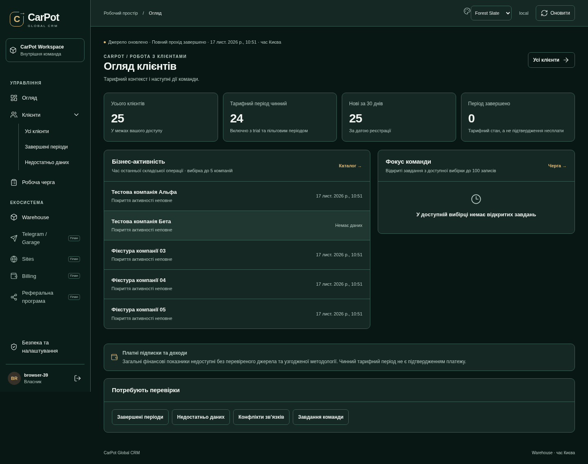

# Global CRM — Review 02 implementation

17 листопада 2026, Київ. Repo `TsPa33/telegram-bot`, гілка
`feature/carpot-control-center-warehouse`, Draft PR #539.
Дизайн і вихідний перевірений head: `3a1e3d664b6f11aa644da02310fc5f91a9846596`.
Це впровадження у чинний React frontend, а не новий статичний prototype.

## Реалізація та екрани

| Компонент | Результат |
| --- | --- |
| `main.tsx` | Global CRM shell, sidebar, breadcrumbs, scoped staff context, refresh, drawer, маршрути й session-invalid teardown |
| `style.css` | Корпоративні tokens Review 02, Light / Onyx / Midnight Gold / Forest Slate, responsive tables/cards, видимий focus, reduced motion |
| `Login.tsx` | Чинний login через серверну політику MFA/password-only; нова корпоративна форма |
| `Overview.tsx` | Компактні scoped KPI, остання відома бізнес-активність обмеженої вибірки, завдання, чинні server-filtered посилання |
| `Directory.tsx` | Пошук, plan/status/link/manager/date filters, підтримуване сортування, server cursor по 20, таблиця/картки, native links і whole-row click |
| `CompanyProfile.tsx` | Повна сторінка клієнта замість CompanyPreview modal; сім вкладок, контакт, квоти, команда, notes, assignment і task launcher |
| `Tasks.tsx` | Чинні завдання, assignee, строк за Києвом, status update, похідна терміновість, native task dialog і focus restore |
| `shared.tsx` | Незалежні loading/error/empty/freshness states, read lifecycle, ігнорування запізнілих відповідей, badges/panels/dialog |
| `model.ts` | Типізовані route/filter/cursor helpers, UNKNOWN precedence, scoped aggregate/null semantics, due urgency |
| `api.ts` | Лише три текстові назви тарифних станів; transport та recovery незмінні |
| `SecuritySettings.tsx` | Лише доступні назви двох чинних форм; password/MFA handlers незмінні |

Екрани: login, огляд, каталог, профіль, робоча черга, безпека/налаштування,
недоступний маршрут. Профіль: Огляд, Продукти, Працівники, Фінанси, Активність,
Нотатки, Історія. Фінанси показані лише дозволеним ролям; прямий заборонений
маршрут не викликає фінансовий endpoint. Telegram/Sites/Billing/referrals лишаються
неактивними пунктами майбутнього плану.

Маршрути використовують hash під чинним `/control/`: deep links, refresh,
back/forward і cursor зберігаються без зміни ASGI fallback, cookie paths чи auth realm.
На вузьких екранах drawer має dialog semantics, inert background, focus containment,
ESC/close/scrim і повернення focus. Закритий drawer недоступний Tab. Native dialog
повертає focus на кнопку створення завдання.

## Дані, права та незмінні контракти

- Дані робочих екранів походять із чинних scoped `/overview`, `/companies`, company
  detail/notes/tasks/assignment і `/tasks`. Global `/staff` запитується лише за
  чинним `can_assign`; Manager/Support не роблять цей привілейований запит.
- Компанії сторінкуються сервером. Filter state і opaque cursor записані в URL.
  Немає вигаданого total або глобального підрахунку на основі поточної сторінки.
- ACTIVE означає чинний тарифний період, не оплату. UNKNOWN/access_incomplete
  не перетворюється на FREE; plan і квоти невідомі, коли evidence неповне.
- Тарифний стан, перевіреність операційного доступу і payment evidence розділено.
  Перевищення 34/10 пояснене квотними одиницями/донорами, без зміни формул.
- Read hooks негайно приховують дані попереднього шляху й ігнорують його запізнілу
  відповідь. Помилка notes або окремого overview widget не блокує інші секції.
- Notes екрануються React; mutation payloads, CSRF recovery, RBAC і audit
  залишаються на наявних серверних механізмах. Нове task creation призначає чинного
  staff згідно з існуючим контрактом; довільного task reassignment не додано.
- Наявний явний role-gated read `/finance` збережено. Нової інтеграції Billing,
  фінансових мутацій або фінансових агрегатів немає.
- Production auth policy, Argon2, cookies, throttling, sessions, CSRF, MFA/password
  rotation, Warehouse Directory worker, entitlement/domain code та міграції не змінено.
  Не читали й не змінювали живі клієнтські БД, credentials або feature flags.

## Чесні обмеження

Повна історія та детальна activity stream недоступні без окремого scoped API.
Огляд показує до п'яти компаній у підтримуваному сортуванні за назвою, не глобальний
рейтинг активності. Черга/її локальні фільтри охоплюють до 100 отриманих завдань,
notes — чинну серверну вибірку до 50, finance records — чинні обмежені вибірки.
Activity sort, daily series, глобальний attention aggregate, MRR/churn/revenue
не активовано. Немає фіктивних чисел, подій або підтвердження платежів.

Функції поточних секцій обмежені наявними API. Сім вкладок не означають сім нових
інтеграцій. Операційний доступ показаний неперевіреним, коли немає відповідного
серверного evidence. Повний WCAG-аудит і runtime acceptance на staging ще потрібні.

## Зображення фактичного React UI

**Synthetic local API fixtures, не живі компанії або staging metrics.**
Одна й та сама production React implementation; дані надходять із disposable API.

[Каталог](screenshots/clients.png) · [Профіль](screenshots/profile.png) ·
[Черга — чесний empty state](screenshots/queue.png) ·
[Mobile 390](screenshots/mobile.png)

## Перевірка та release gate

Implementation SHA: `472d9ad1339c7f714c7b350e98b2932765571650`.
[Незалежний CI](https://github.com/TsPa33/telegram-bot/actions/runs/44050429380):
**4 jobs SUCCESS**, довгий Warehouse regression явно пропущений.

| Перевірка | Результат |
| --- | --- |
| Staff security/projection | 60 PASS |
| Чинний frontend prebuild | 275 PASS |
| Нові model unit | 5 PASS |
| Chromium/WebKit × 4 widths × 4 themes | 32 PASS |
| Manager/Support/Administrator browsers | 6 PASS |
| API failures/out-of-order reads/long name | 4 PASS |
| Password-only/password change/CSRF/logout | 4 PASS |
| Billing compatibility | 145 PASS у CI |
| TypeScript/customer + staff builds | PASS |
| Non-root staff-only image smoke | PASS у CI |

Повний список змінених компонентів наведено вище. Результати і source boundaries — у
[`Checkpoint 012`](../Checkpoint_012_Review_02_Implementation.md).
Browser fixtures — лише synthetic loopback PostgreSQL/API, не production або staging.
Тестовий helper розширено opt-in прапорцем для 25 записів, UNKNOWN/over-quota та
scoped roles; він не потрапляє у staff image.

Для UI-only перевірки workflow має manual input `warehouse_full=false`: довгий
Warehouse domain regression пропускається лише в такому manual run. Звичайні PR/push
gates не послаблено. Staff security, real React browsers, standalone image і Billing
compatibility лишаються незалежними jobs.

Після code review пакет можна передати в окремий контрольований staging rollout.
Розгортання Railway, deployment ID і приймання живої Warehouse Directory до цієї
реалізації не належать. Merge/main/production не виконувалися.
