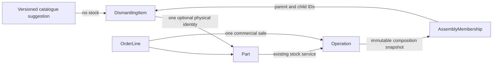

# RFC — assembly/component inventory

Base: integration/volvo-unified-catalogue 27791fb. Local isolated MVP only.
No source catalogue/BOM expansion, seeded real stock, external API or deployment.

## Existing contracts and findings

- Physical truth: Part.quantity/reserved_quantity; inventory.stock() and record().
- Immutable money evidence: Operation.after.sale; Orders own OrderLine snapshots,
  OrderReservation and OrderRequest. Quick sale uses StockRequest.
- DismantlingItem is an existing stable donor placement, optional unique Part link.
  CanonicalPlacement is a catalogue placement, not another physical stock unit.
- Donor actions/receipts and virtual activation ultimately call stock(). Potential
  500+ placements must not be auto-activated by assembly templates.
- No existing financial refund/return service. This MVP supports explicit inventory
  return against the original composition snapshot, NOT automatic cash refunds.
  Gross historical proceeds stay immutable. No invented refund ledger or net-profit
  claim. Full financial reversal needs its own accepted existing-ledger design.



## Model

Navigation remains the existing Category/Subcategory/Type. Physical graph uses
AssemblyMembership(parent_item_id, child_item_id, account_id, vehicle_id, active,
attached_operation_id, detached_operation_id). Composite FKs bind edges to existing
DismantlingItem IDs of the SAME workspace/donor. Partial unique index enforces at
most one active parent. Self-links and cycles are forbidden; DB trigger serializes
edge writers through account NO KEY UPDATE then checks reachability. No DELETE of
memberships. DismantlingItem adds nullable assembly_completeness (unchecked,
complete,incomplete) and assembly_consumed_operation_id. These are independent of
condition/inspection, stock status and category.

Versioned AssemblyTemplate JSON references existing CanonicalPlacement IDs with
quantity/optional/provenance. It is a draft suggestion, validated as an acyclic
bounded tree, never auto-generates stock, fitment or physical membership. Door and
engine examples are synthetic test fixtures only, not factory BOM assertions.

Contained components with a Part retain identity/photos/history and quantity=0.
Attach transfers their standalone unit into the parent via an internal stock
operation (no revenue). A never-stocked potential child can be explicitly confirmed
as present and attached without creating a Part or quantity. Detach materializes
or reuses its one Part via stock(receipt), and marks ALL ancestors incomplete.
A potential/template edge never counts as an actual attachment. Reconfirming a
partial node requires explicit composition review; no automatic completeness.

## Locking / concurrency

All public Part FOR UPDATE ownership lookups acquire the existing workspace account
NO KEY UPDATE lock BEFORE Part. Donor writers already take account→Vehicle; Orders
already take account→Order→sorted Parts. Assembly commands take account→Vehicle→
sorted items/Parts; stock guard operates inside this same transaction. Direct SQL
edge trigger also takes the account lock. This intentionally serializes writes per
workspace (existing Orders strategy), avoiding ancestor/child lock inversion and
allowing bounded graph reads without competing graph mutations. No cross-workspace
locks. Never acquire an Order lock from stock() after Part locks.

Stock guard always enforces installed graph invariants, even if the UI feature flag
is disabled. Root consumption locks the full actual subtree deterministically.
Incoming membership blocks independent receipt/sale/reserve/correction/write-off.
Reserved roots prevent detaching/reassembling; reserved components prevent attach.
All-in-one order lines containing ancestor and descendant are rejected atomically.
No silent reservation release: existing OrderReservation owner checks remain.

## Sales / returns

Preview returns an exact membership/Part state token and flattened composition,
not a template or all catalogue types. Root sale requires this token. Incomplete
assembly requires explicit remainder mode + accurate seller description; “в зборі”
is rejected for remainder. OrderLine stores server-confirmed assembly metadata in
its existing donor_snapshot; commercial line naming is explicit, not Part rename.
Standard stock validation still enforces quantity/reserves. Component operations
are assembly_included_* with root operation/order IDs, never type=sale or money.
A returned assembly checks original IDs/memberships and current zero quantities,
restores only its standalone root through stock(), clears consumed markers and
records inventory return against original Operation. It never reattaches a previously
detached component. Exactly-once request keys use existing DismantlingRequest.

Feature flag ASSEMBLY_INVENTORY_ENABLED=false by default controls editing/UI/API.
Installed graph guards cannot be bypassed by toggling this flag. Legacy parts and
orders without membership retain their usual stock behavior.

## UI / scale

Existing dismantling tab gains an optional inline tree. A single bounded read loads
existing donor items + edges + Parts; client renders collapsed roots and only expanded
branches, with search retaining ancestors. No per-node network requests. Potential,
confirmed attached, standalone and included-in-sale counters are distinct. Templates
remain opt-in suggestions. No real vehicle or quantities copied from mock diagrams.

## Migration and rollout

One additive PostgreSQL revision after e641b3a20f97. New nullable fields/default-empty
tables; no existing quantity, reserve, price, order, sale or catalogue backfill.
Apply/test ONLY on a dedicated local database. Review existing schema + single head
before staging approval; deploy backend first with flag OFF, frontend next. Enable
only after local integration/concurrency/browser evidence and separate staging
approval. No production operation is authorized.

Rollback: disable new creation/UI, keep stock guards and new evidence/schema.
Do NOT downgrade while graph/history rows exist; old code cannot safely enforce
containment. Restore a prior application only after verifying no assembly data were
created. No automatic destructive downgrade or quantity repair.

Implementation/test evidence and exact residual limits are appended below.


## MVP boundaries and safety decisions

- Attach explicitly confirms actual presence; no type-name/OEM similarity establishes
  membership. Components with positive separately assigned unit_cost are blocked from
  attach until cost allocation is resolved. No automatic cost transfer or fake margin.
- One node = one physical unit. Attaching existing Parts marks them individually
  tracked; a detached component cannot later become a multi-unit lot. Quantity>1
  needs explicit split into separate placements first.
- A root without a Part can receive exactly one explicitly confirmed physical unit
  through the EXISTING dismantling receipt service, with Catalogue kind/staleness
  checks retained. This never receives its potential children automatically.
- Editing donor/Part identity cannot rebind an installed physical graph. DB triggers
  protect node.Part links and Part donor changes against other plan/update paths.
- Active reservations include order links in authorized previews. No release is
  performed on behalf of another order. Snapshot records damaged/absent inspection.
- A direct component sale requires explicit detach first. No hidden disassembly in
  the order service. It is a conservative workflow, not automatic BOM consumption.
- Templates are immutable opt-in suggestions over existing canonical placements;
  this MVP stores/validates them but does not auto-instantiate or auto-confirm BOMs.
- Return is whole-assembly inventory-only. Partial returns, cash refunds and automated
  cost redistribution are deliberately unavailable, not claimed implemented.
- Workspace write serialization also moves account locking before employee actor-row
  locking in identity(), avoiding team-management/stock lock inversion. Authentication,
  CSRF, effective rights and workspace selection decisions remain unchanged.
- Physical tree shares the existing dismantling tab and stock API. It does not replace
  catalogue navigation, Plan.Parts, finance, photos or historical receipts.

## Verification evidence (local only)

- `tests/test_assemblies.py`: 16 PASS, disposable PostgreSQL16. Includes door+12,
  nested engine, detached generator, one priced sale, remainder description, no
  child revenue, manual/order reserves, atomic root/child race, payload/key replay,
  final-component rollback, return replay, cycle/second parent, cross-workspace and
  cross-donor rejection, RBAC, flag-off guards, immutable physical links, no-stock
  potential552, template versions/cycles, legacy Part adoption and legacy request
  fingerprint compatibility. Exact Part IDs are preserved.
- Latest combined assembly+orders run:37 PASS (16 assembly +21 orders).
- Separate legacy focused regression run:71 PASS /4 historical downgrade cases
  deselected (overlaps assembly/orders; not an additional unique total).
- Additional assembly+v3-plan run:33 PASS /2 deselected (overlaps; sourceA and
  historical migration case excluded). No claim to real VolvoB acceptance.
- Frontend targeted units:40 PASS. TypeScript/Vite build PASS; existing bundle-size
  warning remains. No new external runtime dependency.
- Chromium1440/390 against guarded local PostgreSQL: PASS. Synthetic552 placements,
  13 actual physical Parts, one standalone root after attaching12; collapse/search,
  exact composition preview, actual local quick sale, reload, zero JS errors/page
  horizontal overflow and no per-node requests. Day/Night checked separately by
  built theme switch. Screenshots in `assembly-inventory/screenshots/` are synthetic.
- Forward migration check from a POPULATED e641b3a20f97 database to f7a10b8c43d2:
  PASS. Existing vehicles, Parts(quantity5,reserved2,USD123.45), Operation, buyer,
  order/line and plan preserved exactly; new columns NULL, zero new memberships.
  `tests/assembly_upgrade_check.py` refuses non-local/non-empty targets.
- `alembic heads`: single f7a10b8c43d2. `alembic check` finds only an existing
  vehicle-directory index naming discrepancy: ix_vehicle_directory_account_id vs
  ix_vehicle_directory_variants_account_id. No assembly-model schema diff reported.

### Existing test limitations, not hidden passes

Historical tests that expect downgrades to pre-paid-evidence schemas are incompatible
with the current forward-only lineage. Initial broad runs stopped at old currency,
legacy dismantling and virtual populated-downgrade tests; subsequent runs excluded
historical migration/downgrade cases. The new parent→head populated-data test above
verifies the actual migration instead, without weakening downgrade protection.

`test_real_A_xc90_plan_and_multiple_donors` fails with409 “Потрібен новий preview”
in the existing catalogue-import preview/apply flow. The EXACT failure was reproduced
from untouched base27791fb in a temporary copy and its own local PostgreSQL database.
This task does not change that unrelated importer. Real catalogueA/B source coverage
is not established by synthetic assembly fixtures. No paid provider calls occurred.

### Reproducible local commands

Only a dedicated localhost:55441 warehouse*_test PostgreSQL may be used. Existing
pytest conftest upgrades/truncates that dedicated DB; never set these variables to
Railway or operational databases.

```sh
# Use your local test-only connection URL, never a Railway URL.
WAREHOUSE_TEST_DATABASE_URL="$LOCAL_ASSEMBLY_TEST_URL" python -m pytest tests/test_assemblies.py tests/test_orders.py -q
# New empty local database named warehouse_assembly_upgrade*_test is required:
WAREHOUSE_ASSEMBLY_MIGRATION_TEST_URL="$LOCAL_EMPTY_UPGRADE_TEST_URL" PYTHONPATH=. python tests/assembly_upgrade_check.py
```

Run backend commands from warehouse/backend. Browser harness is guarded by
WAREHOUSE_E2E=1, WAREHOUSE_ENV=local and localhost:55441 test DB, enables assembly
only locally and disables Plan.Parts. Start tests.assembly_browser_server on8031,
Vite preview on5231 with WAREHOUSE_API_PROXY=http://127.0.0.1:8031, then run
`WAREHOUSE_E2E=1 node tests/assembly-browser.mjs` in warehouse/frontend. Never run
pytest truncation concurrently with the browser against the same database.

## Release acceptance still required

No push, Railway migration/deploy, production, MySQL, live source, real donor, stock
or financial mutation was performed. Changes are confined to /warehouse in the
isolated feature branch. No factory assembly templates are seeded. The current
MVP has no automatic template application, bulk disassembly, partial returns or
cash refunds. Existing ledger operations remain the only quantity/money authority.
Before a separately approved rollout, review the migration on the actual target,
resolve or explicitly accept the unrelated regression limits, test an authorized
staging workspace, and validate costing/return policy with the owner. Keep the
feature OFF until that acceptance. Never roll old unguarded stock code over a
populated assembly graph.

## Implementation map

- `backend/app/models/assemblies.py`, DismantlingItem extensions and
  `backend/alembic/versions/f7a10b8c43d2_assembly_memberships.py`: schema and guards.
- `backend/app/services/assemblies.py`: graph, composition, attach/detach, preview,
  receipt/adoption, consumption, return, templates and existing replay mechanism.
- `backend/app/services/inventory.py`, `orders.py`, `dismantling.py`,
  `virtual_inventory.py`: shared invariant enforcement without a second ledger.
- `backend/app/api/assemblies.py`, route registry/permissions/main: opt-in API.
- `backend/app/api/deps.py`: consistent workspace-before-actor mutation locking;
  `api/routes.py`: Part identity guard, compatible fingerprints and card context.
- `frontend/src/AssemblyTree.tsx`, `assembly-tree.css`, `GlobalCatalogueFlow.tsx`:
  inline tree and controlled actions. Existing PartCard/StockHistory gain contextual
  assembly labels and order links, with no second product/card system.
- `backend/tests/test_assemblies.py`, guarded browser/upgrade harnesses and
  `frontend/tests/assembly-browser.mjs`: repeatable local evidence.

Legacy/manual/Plan.Parts physical Parts can be explicitly adopted through
`link_part` without creating another Part or changing quantity. Existing category
IDs/names are reused. This is not an automatic migration of historical plans.
