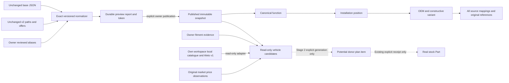

# Dismantling Catalogue v3 — Stage 1

Актуальне розширення: [Stage 1.5 — перевірене покриття, групове погодження та VIN-ready контракт](stage-1.5/README.md). Нижче збережено історичний звіт Stage 1.

Local implementation after `133e9b90ef734b46faa2121b711dc8ac32aec9bb`, branch `feature/carpot-warehouse-mvp`. All changes are under Warehouse. No push, deployment, staging normalization/publication, production operation or merge was performed.

The v2 `part_type` is a source title grouping, not a constructive type. V3 adds a separate immutable reference layer. The old generator is deliberately not switched: existing donor plans continue using their old source/key references. This stage exposes a read-only canonical candidate service for the next generator, and never creates `Part` or `DismantlingItem`.

## Architecture



A function such as Generator can have many model/OEM variants and source offers while supplying one installation candidate. Left/right and front/rear remain different placements. Upper/lower/inner/outer mounting refinements also remain separate. Variant identity is independent from the function identity: matching OEM never establishes function or interchangeability.

## Base-catalogue audit

The unchanged `app/data/dismantling_catalog.json` contains **33 positions and 22 distinct functional names**. Examples: four door positions become one Door function with four placements; two headlights become one Headlight function with two placements. The base Generator and a verified global Generator resolve to the same UUID. No old JSON key, category, plan or local source is renamed.

The checked-in vocabulary contains those base functions and three explicit additional functions observed in real A: Fog light, Alternator bracket and Starter-generator wiring. A bracket is not merged into its alternator. These are exact function rules, not a target count. Only functions present in the input or base are published; new types may be explicitly defined by the owner with evidence.

## Schema and history

Additive Alembic head: **`5c7d9e1a320f`**, parent **`41f9a2c87d10`**. Eight new tables, no old-table UPDATE/DELETE or data backfill:

| Table | Purpose |
| --- | --- |
| `canonical_types` | Stable function UUID + normalized category/subcategory/name identity; Ukrainian label and provenance |
| `canonical_placements` | Function + side/longitudinal position + other mounting details; unique stable identity |
| `canonical_variants` | Function/placement + opaque OEM + model/generation/year/constructive descriptors; no interchangeability claim |
| `canonical_aliases` | Append-only owner approvals, scoped exact phrase or exact source key/SHA; optimistic revisions and withdrawal history |
| `canonical_fitments` | Append-only explicit positive/negative owner evidence for a variant and vehicle criteria |
| `canonical_runs` | Durable queued/running/done/error preview/publication commands, actor/session hash, token/report/source snapshot |
| `canonical_state` | Atomic pointer and rules/alias policy for the published snapshot; empty after migration |
| `canonical_mappings` | Every base/v2 source record, source fingerprint, original path FK, mapping quality and full provenance for a snapshot |

Composite FKs keep type, placement and variant consistent. The six reference/history tables reject UPDATE/DELETE with their own new trigger; new approvals/publications append history. Existing v2 aliases, categories, offers, prices, applications, paths and warehouse audit are untouched. Mapping history pins the source attributes used for normalization, URL, original path, owner alias IDs and rule fingerprints; remaining offer/price data stays linked in its existing tables. Repeating unchanged publication reuses deterministic IDs and adds no duplicate reference rows; run history records explicit commands.

Base mappings preserve `source=carpot.base.v1` and the original `catalog_key`. V2 mappings link directly to existing path IDs and retain provider, article, offer ID, URL, raw category path and original title/OEM. Workspace-local sources and Aleto v1 are never published into global tables: their read adapters preserve the old source/catalog-key or taxonomy/offer references only in the authorized vehicle response.

## Deterministic matching

`canonical_rules_v1.json` is a reviewable, exact UA/RU functional vocabulary. The executable parser plus vocabulary and Unicode version are fingerprinted. Source/model data, full source fingerprints, approved alias revisions and v2 catalogue revision participate in the preview token. A changed parser cannot silently reinterpret a published snapshot: it requires a new explicit normalization/publication.

Known branding/model tokens, explicit model-adjacent abbreviated year labels, labelled modification codes, engine labels, ratings, material and assembly descriptors are separated from the function phrase. Cosmetics are retained in provenance. Constructive descriptors remain in variant attributes, not discarded. Abbreviated `16-22` remains an unverified literal label; the normalizer does not infer a century or fitment. `Генератор 12-24` without a clear model/year context remains unprocessed. Engine labels such as T5 are descriptive source data, not verified applicability.

After these bounded transformations the **entire remaining phrase** must match a checked rule in a compatible category context. There is no substring/fuzzy/OEM-only merge and no runtime AI approval. Unknown labels, unsupported qualifiers, missing required placement, contradictory left/right/axes, conflicting owner aliases and source changes remain in review/unprocessed states. Published candidates include only verified functions; unmapped counts and source references remain visible, and the owner review queue is paginated.

Owner aliases require either an exact current source key/SHA or a complete phrase plus explicit category and subcategory context. Direct source decisions take precedence over broad phrase approvals. Conflicting approvals are not guessed. An approval can be corrected/withdrawn by appending a new optimistic revision with evidence; publication is still explicit. Old records remain inspectable.

OEM is opaque: no splitting, separator removal, leading-zero removal, fuzzy grouping or cross-model union. Variants retain the source model and constructive descriptors and have `interchangeability=unverified`. Missing OEM yields an explicitly source-scoped unknown variant. Missing prices stay null, never zero.

## Read-only candidate API

Authenticated users with `catalog.view` can query:

```text
GET /api/v1/catalogue/canonical/candidates?manufacturer=Volvo&model=XC40&year=2020&engine=T5
GET /api/v1/catalogue/canonical/sources?placement_id=<id>&offset=0&limit=50
```

For actual vehicle data and own legacy sources, the tenant-scoped route additionally requires `vehicles.view`:

```text
GET /api/v1/vehicles/<id>/dismantling/candidates?offset=0&limit=100
```

Inputs cover the existing structured vehicle fields: manufacturer, model, generation, year, engine, fuel and transmission. No VIN/KType inference or external lookup is performed. The generic route has no access to private vehicles or workspace-local catalogues. The vehicle route derives workspace from the session, checks ownership and joins v1/local rows with that workspace only.

Outputs include function/name/category/subcategory, installation details, known OEM variants, distinct provider/article offer count, rule/owner quality, variant-level fitment, reference prices by currency (min/max, observation count and latest date), source references and unmapped counts. Reference prices never become selling prices. Source refs are capped at 50 with an explicit count/truncation flag; the shared sources endpoint paginates the complete published global mapping provenance. Original price history remains in its existing tables; values are read dynamically, not copied or overwritten by normalization.

Fitment statuses are `confirmed`, `possible`, `unknown`, `incompatible`. A model grouping can establish only a possibility; unknown equipment stays unverified. Conflicting title model labels lower it to unknown. Only explicit owner evidence covering the requested known criteria can confirm or reject a variant. Absence of a positive match is not evidence of incompatibility. Overlapping contradictory assertions return unknown. Group-level `confirmed` means **at least one variant**, not that every OEM is interchangeable. No status automatically excludes an existing plan item.

Before the first publication the new API returns `published=false` and empty candidates. It does not seed/import anything. The old generator continues working as before.

## Owner workflow and API

All writes and review/history endpoints require the existing active root DIRECTOR platform-owner allowlist **and** an authenticated session/CSRF. `catalog.import`, another workspace DIRECTOR, request actor IDs and a missing allowlist cannot confer global rights. Ordinary small governance writes fail fast with 409 while import/normalization holds the shared lock.

1. Explicit preview, HTTP 202:

```text
POST /api/v1/catalogue/admin/canonical/runs
{"mode":"preview"}
GET /api/v1/catalogue/admin/canonical/runs/<run-id>
```

2. Only after preview is done, explicitly publish using its ID/token:

```text
POST /api/v1/catalogue/admin/canonical/runs
{"mode":"publish","preview_id":"<done-preview-id>","token":"<64-hex-token>","confirm":true}
```

Publishing a partial guide stores unresolved records as review evidence, not approved parts. Changed sources/rules invalidate the token and leave the previous publication intact.

3. Curate unknown records through owner-only endpoints:

```text
GET  /api/v1/catalogue/admin/canonical/review?offset=0&limit=50
POST /api/v1/catalogue/admin/canonical/types
POST /api/v1/catalogue/admin/canonical/aliases
GET  /api/v1/catalogue/admin/canonical/aliases
POST /api/v1/catalogue/admin/canonical/fitments
```

Type creation requires Ukrainian name/category/subcategory and evidence. Alias approval requires target type, scope, evidence and `expected_revision`. Fitment evidence requires a variant, explicit criteria and positive/negative status. Refer to OpenAPI schemas for exact bounded fields. Local-source unknowns are not imported into the global review queue: they remain own-workspace read-only unmapped references.

The existing background worker polls explicitly queued normalization runs after v2 work, sharing the same process/session advisory coordinator and transaction fencing lock. Separate worker DB connections avoid tying execution to the HTTP request. A process crash rolls back publication and leaves the prior snapshot active; abandoned running commands become an error and require explicit retry. Queued commands may resume only because the owner already explicitly requested them. Successful publication and run completion commit atomically. No startup scan of old import jobs, bundled catalogue, existing plans or stock occurs. No extra Railway variable/service is required; the existing worker enable flag also controls this queue.

## Validation and measured data

Implementation commit: `d214ba16ee906b0a3b1e4a89ddcddda8568b5b5c`.

| Metric | Real bundled A | Synthetic scale fixture |
| --- | ---: | ---: |
| Source offers | 7246 | 10222 |
| V2 taxonomy paths | 14400 | 29922 |
| Published functions, including base | 25 | 23 |
| OEM/constructive variants | 104 | 80 |
| Installation positions, including base | 38 | 34 |
| Verified mapping rows, including base | 262 | 23973 |
| Ambiguous mapping rows | 0 | 0 |
| Unprocessed rows requiring owner review | 14171 | 5982 |
| Offers with a verified function | 105 | 8178 |
| Trusted offer fraction | 1.45% | 80.00% |

Real A has 10 112 model links; the synthetic fixture has 14 324. Mapping-row counts include the 33 unchanged base positions. For A, 262 verified rows are 33 base + 229 source paths, covering 105 unique offers; **7 141 offers still lack a verified functional mapping**. Zero ambiguous rows in this dataset does not mean zero uncertainty: the 14 171 unprocessed paths are explicitly awaiting review. The 25 function count is the resulting published vocabulary, not a requested target. The synthetic fixture produces 23 functions because its inputs differ.

Real staging B (10 222 offers / 14 324 applications / 29 922 paths / 9 452 old v2 part_type records) is user-provided context only. Its actual ZIP/data were unavailable to Codex and were not normalized or inspected here. The matching-sized scale fixture is synthetic and its 80% coverage is by construction, not a prediction for B.

Measured locally on PostgreSQL 16: synthetic preview **9.307 s**, publication **18.104 s**, repeat preview **10.006 s**, repeat publication **15.538 s**; peak process RSS **512.2 MiB**. Source-table fingerprints and reference-record counts remained unchanged on repeat. These timings include concurrent local verification load and are not Railway SLAs.

Evidence files: [real-A-validation.json](real-A-validation.json), [synthetic-scale-validation.json](synthetic-scale-validation.json).

Checks completed:

- Full backend run: **312 passed, 1 skipped** (opt-in 100k search benchmark), 286.20 s.
- Final dedicated v3 run after the last provenance/variant refinements: **27 passed**, 49.62 s. Final source pagination/variant-FK/migration checks: **3 passed**, 4.67 s. These runs overlap; counts are not summed.
- Frontend: **267 unit tests passed** (team 58, smart search 74, workshop 111, catalogue draft 24); TypeScript/Vite build passed. Only additive-head compatibility changed in frontend.
- Sole Alembic head, upgrade/downgrade roundtrip on populated local DB, `alembic check`, immutable reference history and old-table fingerprints passed. A downgrade cleanup defect found during development was corrected before the passing checks.
- Covered: five alternator offers → one type; OEM/model separation; left/right and other mount axes; same labels in different domains; exact UA/RU synonyms and modifiers; missing prices/OEM; fitment unknown/positive/negative; conflicting/withdrawn aliases; repeat; queued/crashed work; ordinary reads while worker runs; CSRF/allowlist; old base/v1/v2/local references; existing stock, personal prices, sales, finance/audit and donor plans unchanged.

## Local reproduction

Tests and benchmark erase only an explicitly selected disposable test DB; never point them at staging or production. Use the existing locked Warehouse environment/dependencies.

```bash
cd warehouse/backend
WAREHOUSE_TEST_DATABASE_URL=postgresql+psycopg://postgres@127.0.0.1:5432/warehouse_catalogue_v2_suite_test python -m pytest tests/test_canonical_v3.py -q
python -m alembic heads
# Optional report output: WAREHOUSE_CANONICAL_TEST_REPORT=/tmp/canonical-real-A-report.json
# A separate disposable perf DB must already be migrated to head:
WAREHOUSE_TEST_DATABASE_URL=postgresql+psycopg://postgres@127.0.0.1:5432/warehouse_catalogue_perf_test python scripts/benchmark_canonical_v3.py --confirm-disposable
```

The scale script rejects non-loopback/non-warehouse/non-test databases and requires explicit disposable confirmation. It does not contact Railway. No additional dependencies are required.

## Limitations and Stage 2

**This is a functioning Stage 1 reference/normalization system, not a fully curated automatic donor generator.** Real A coverage is intentionally conservative and too low to claim comprehensive automatic plans. Broader market taxonomy labels such as “Електроніка”, “Датчики”, “Комп” or generic control blocks are not promoted to constructive types. Unknown residuals/complex assemblies need owner definition and evidence. OEM spelling/unknown options may conservatively split variants; interchangeability remains unverified. All old and pending source evidence is retained.

Before Stage 2:

1. Run a separately authorized preview on the actual staging B data; review coverage and the pending queue. Expand the exact Ukrainian functional vocabulary through owner-scoped definitions/aliases, with dedicated fixtures for new functions and complex assemblies. Do not choose a target type count or fabricate coverage.
2. Validate generation/year/powertrain/equipment applicability against actual technical evidence; curate explicit fitment assertions. The current service does not infer equipment from VIN/KType or create new cross-model applications.
3. Add an explicit generator preview UI backed by the canonical candidate API. Let the user resolve generic-versus-specific installation refinements and unknown variants, and show evidence/compatibility. For large guides, profile/cap or paginate variant lists and cache read snapshots with revision checks.
4. Only after separate approval add nullable canonical references to *new* plan items, idempotent generation keys and a user-confirmed create transaction. Preserve old source/key references and existing plans; no mass migration, exclusion or receipt.
5. Keep stock receipt as the existing separate explicit action. Do not infer quantities, financial values or selling prices from source offers.

For any future staging release, verify the existing backup/recovery procedure, resource headroom and schema revision first. Migration alone leaves canonical publication empty; no catalogue or donor plan is populated during startup. Publishing/curating the guide remains a separately authorized owner action.
