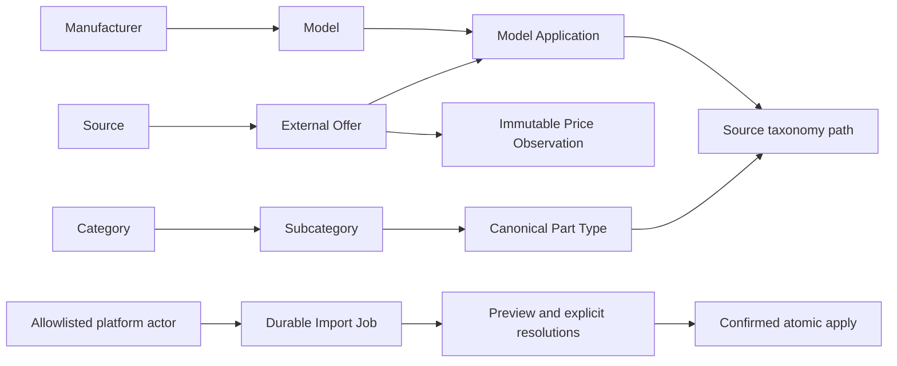

# Universal Catalogue v2 — Stage 1–2

Backend та frontend локальні коміти слід розглядати як одну майбутню release-одиницю; окремого розгортання між ними не виконувалося.

Локальна реалізація поверх `9589e5e7bf4b7c694c885ddbdab62f18ea079715`, гілка `feature/carpot-warehouse-mvp`. Усі зміни під `warehouse/`. Не виконувалися push, deployment, Railway Variables, staging/production import або операції з основним Telegram-ботом.

## Цільовий аудит та архітектура

Aleto v1 зберігає `aleto_models`, `aleto_offers`, `aleto_prices`, `aleto_applications` і `aleto_taxonomy` окремо для workspace. Його `categories` — tenant-local; `dismantling_items` — план потенційних деталей, не фізичний склад; `vehicle_catalog` повертає локальні підказки назв. V1 не має глобального platform-owner import jobs. Його історичні записи та маршрути залишено чинними, автоматичного перенесення даних немає.

V2 додає **спільний reference catalogue**, без `account_id` у марках, моделях, категоріях, типах, пропозиціях, застосуваннях чи цінах. `Account` використовується лише як автор import job та підтвердженого alias. Власники інших складів не повинні повторювати імпорт для читання цих даних. Tenant-specific `parts`, `vehicles`, ціни продажу, резерви, продажі, замовлення й історія не підключені до мутацій v2.



Зв'язок моделі з категоріями та типами проходить через source application/path. Це опис груп джерела, не авторитетний fitment за роком/VIN. Не додаються рекомендована ціна, автоматичний selling_price чи реальні складські позиції. Поточний v1-план розбору не змінено; v2 лише розширює джерело назв у формі автомобіля і додає спільний довідник на сторінку каталогу.

## Схема та міграція

Єдина нова ревізія: `021e8f6f220c`, parent `b8716962f6b8`. Upgrade створює лише дев'ять нових таблиць, індекси, обмеження, порожній state (revision 0) і тригер незмінності price observations. Немає UPDATE/DELETE старих таблиць чи масового backfill.

| Таблиця | Ідентичність і дані |
| --- | --- |
| `catalogue_entities` | Типізовані `manufacturer`, `model`, `category`, `subcategory`, `part_type`; self-FK і CHECK визначають допустимі батьківські типи. Унікальний `identity_key`, стабільний UUIDv5 |
| `catalogue_aliases` | Явно підтверджені platform owner відповідності: kind, parent context, нормалізоване ім'я/ознаки → existing entity; унікальний контекст; FK перевіряє kind target |
| `catalogue_sources` | Стабільний унікальний ключ провайдера |
| `catalogue_offers` | UNIQUE(source_id, source_article); вихідні властивості, остання дата спостереження. OEM не є ключем пропозиції |
| `catalogue_applications` | UNIQUE/PK(offer_id, model_id), typed FK лише на model |
| `catalogue_paths` | Raw модель/таксономія/назва/OEM/side/position/роки/покоління, optional canonical type. Невирішений або явно пропущений type не перетворюється на вигадану деталь |
| `catalogue_prices` | UNIQUE(offer_id, observed_at), UAH/USD nullable Numeric(14,2), URL. PostgreSQL trigger відхиляє UPDATE/DELETE |
| `catalogue_jobs` | Автор, ім'я/формат/SHA upload, валідовані рядки та їх SHA, рішення, preview token, версія каталогу, статус і звіт; timestamps |
| `catalogue_state` | Singleton revision, що змінюється тільки після фактичних мутацій каталогу |

Центральний каталог використовує Unicode NFC, casefold, нормалізацію whitespace й апострофів. Модель має parent manufacturer і покоління в ідентичності. Категорії глобальні; підкатегорія обмежена батьківською категорією. Тип деталі має власну назву та окремі OEM/side/position, які беруть участь в ідентичності; не підставляється назва підкатегорії. Повна назва Aleto v1 зберігається; невідомі ознаки не вгадуються.

V1 → v2: platform owner явно завантажує існуючий SQLite/GZIP через адаптер у новий job і перевіряє preview. Це створює глобальні source reference rows один раз, не змінюючи наявних tenant-local v1 записів. Нічого не переноситься при startup. V1-копії надалі можна лише окремо погоджено архівувати/виводити з використання; у цьому етапі їх не видаляють.

Downgrade видаляє тільки новий глобальний каталог/jobs. Він не видаляє v1 чи склад. Після реального наповнення глобального каталогу downgrade втрачає його нові reference/history rows: перед таким окремим рішенням потрібен backup, це не штатний «undo import».

## Власник платформи та безпечна активація

Сервер читає `WAREHOUSE_CATALOG_PLATFORM_ADMIN_IDS` як список actor UUID через кому. Значення за замовчуванням — порожнє: імпорт заборонено. Актор має бути активним DIRECTOR без parent workspace; факт перевіряється через поточну авторизовану сесію, не через ID клієнта. Відкликання сесії й зміна ролі/активності перевіряються перед операцією. Навіть allowlisted ADMIN/MANAGER відхиляється.

`catalog.import` залишився дозволом лише старих tenant-local імпортів. Він не дає доступу до глобального admin API. Глобальні endpoints мають незалежний platform check, автентифікацію, CSRF і штатний staging Origin policy. Меню приховане для інших користувачів; прямий HTTP-запит також отримує 403.

У цій задачі Railway Variables **не змінювалися**. Після окремого погодження релізу оператор має встановити **лише у Warehouse API сервісі `telegram-bot`, project `selfless-caring`, environment `warehouse-staging`**:

```text
WAREHOUSE_CATALOG_PLATFORM_ADMIN_IDS=bf89801e-2732-4605-9a4b-f65748cf4bf2
```

Це наданий користувачем staging actor ID, лише приклад конфігурації, не hardcode коду. Не змінюйте shared/production Variables, Team Management, реєстрацію чи існуючі DB bindings. Зміни Variables можуть запустити rollout, тому активація залишається окремою операцією. Після майбутнього погодженого rollout `/api/v1/auth/me` саме цього актора повинен показати `catalogue_platform_admin=true`; для звичайного DIRECTOR — false.

## Вебпроцес

**Адміністрування → Каталог → Імпорт** (`/administration/catalogue/import`):

1. Завантажити CSV/ZIP v2 або Aleto v1 SQLite/GZIP. Це створює persisted `uploaded` job, не змінює каталог. Відхилені файли мають metadata-only `failed` job без зберігання небезпечного payload.
2. Натиснути «Побудувати preview». Один і той самий planner виконується у SQL savepoint, який відкочується. Зберігаються лише job/report/resolutions; звіт містить `mode=preview`, `committed=false`, inserted/updated/unchanged, перші 50 нових цінових спостережень із попередніми значеннями, невирішені відповідності та пропозиції ручних об'єднань.
3. Для неоднозначних назв вибрати існуючий target у **тому самому kind/parent context**, ввести перевірену назву або явно пропустити зіставлення. Для звичайної нової назви можна розкрити «Нові записи та ручне об'єднання», щоб підтвердити alias замість створення нового entity. Жодного fuzzy auto-merge.
4. Зміна рішень вимагає нового preview. Застарілі/непов'язані рішення відхиляються; за потреби очистьте залежні рішення, якщо змінили батьківську відповідність.
5. Apply можливий тільки для `ready` job з нулем unresolved, актуальним preview token і checkbox підтвердження. Неправильний/старий token чи змінена версія глобального каталогу дає 409 і вимагає нового preview.
6. Apply атомарно застосовує перевірений план, записує `applied` report, автора і час. Повтор того самого запиту після втрати відповіді повертає той самий applied job. Старі записи, відсутні у новому файлі, залишаються.

Невирішена відповідність не зливається тихо. Явний skip типу/підкатегорії зберігає пропозицію, спостереження, модель і raw-шлях без canonical type; skip конфлікту джерельної пропозиції пропускає всю її групу. Якщо однаковий артикул має різні вихідні властивості всередині файла або суперечливу ціну за одну дату, потрібно виправити файл або явно пропустити групу. Замінити вже збережені metadata можна тільки явним `accept_incoming`; `keep_existing` залишає їх чинними. Price history не переписується навіть із таким підтвердженням.

Preview й apply беруть один PostgreSQL advisory transaction lock. Apply також блокує job і перевіряє singleton revision. Конкурентні різні jobs не можуть використати застарілий preview; другому потрібен новий preview. Повтор одного apply серіалізується і не дублює дані. При збої процесу до commit PostgreSQL відкочує каталог разом зі статусом job; `uploaded`/`ready` залишається доступним для повтору. Не зберігається committed «applying», який міг би зависнути назавжди.

## Читання всіма складами

На сторінці «Каталог запчастин» розкрийте **Спільний каталог CarPot v2**. Фільтри: модель, категорія, підкатегорія, назва/OEM/артикул; пагінація пропозицій. Відображаються джерело, OEM, URL, UAH/USD і дата останнього спостереження. Це **ринкова пропозиція джерела**, не рекомендована ціна і не ваша selling_price. Нові глобальні марки/моделі доступні у штатному `/vehicle-catalog` для додавання автомобіля без копіювання каталогу в workspace.

API читання: `GET /api/v1/catalogue`, `GET /api/v1/catalogue/entities`, потребує `catalog.view`. Admin API: `GET /api/v1/catalogue/capabilities`; `POST /admin/jobs` (binary body + `X-Catalogue-Filename`); `GET /admin/jobs`, `GET /admin/jobs/{id}`, `POST /admin/jobs/{id}/preview`, `POST /admin/jobs/{id}/apply`, `GET /admin/entities` — усі під `/api/v1/catalogue`, усі authenticated; admin routes окремо require platform owner. Upload не використовує публічного endpoint, multipart parser або довільного server path.

## Наступний файл парсера

Підготуйте [CSV/ZIP за FORMAT.md](FORMAT.md), використовуючи той самий `source` і стабільний `source_article`. Для нових цін надайте справжній новий `observed_at`, не дату upload. Не придумуйте OEM/роки/side/position, якщо парсер їх не знає. Перевірте preview і pending review, потім окремо підтвердьте apply. Приклади [Volvo initial/increment та BMW/Audi](../../examples/catalogue-v2/README.md) синтетичні й не є ринковими даними.

## Локальна перевірка

Використовуйте окрему PostgreSQL БД з назвою `warehouse*_test`; тести її очищують. Не підставляйте staging URL.

```bash
# warehouse/backend, активний Python 3.11+ venv із requirements.lock
export WAREHOUSE_TEST_DATABASE_URL='postgresql+psycopg://postgres@127.0.0.1:5432/warehouse_catalogue_v2_suite_test'
python -m pytest tests/test_catalogue_v2.py -q
python -m pytest tests unit_tests -q
# Для тієї ж локальної тестової БД:
WAREHOUSE_DATABASE_URL="$WAREHOUSE_TEST_DATABASE_URL" python -m alembic check

# warehouse/frontend
npm ci
npm run build
```

Для браузерних перевірок створіть локальний тестовий DIRECTOR (через форму реєстрації), задайте його згенерований ID у `WAREHOUSE_CATALOG_PLATFORM_ADMIN_IDS` **лише локального API процесу**. Приклади команд — для shell з уже налаштованими тестовими змінними, не Railway:

```bash
# warehouse/backend, окрема *_browser_test БД:
WAREHOUSE_DATABASE_URL="$WAREHOUSE_BROWSER_TEST_DATABASE_URL" \
  WAREHOUSE_COOKIE_SECURE=false \
  WAREHOUSE_CATALOG_PLATFORM_ADMIN_IDS="$CATALOGUE_TEST_OWNER_ID" \
  python -m uvicorn app.main:app --host 127.0.0.1 --port 8020
# warehouse/frontend, окремий термінал, локальний production-assets preview:
WAREHOUSE_API_PROXY=http://127.0.0.1:8020 npm run preview -- --host 127.0.0.1 --port 18766 --strictPort
# CATALOGUE_TEST_EMAIL / CATALOGUE_TEST_PASSWORD — облікові дані тільки тестового актора.
WAREHOUSE_E2E=1 node tests/catalogue-v2.mjs
```

Runner перевіряє desktop/mobile, upload/preview без запису каталогу, reload/persisted job, явне об'єднання, обов'язковий новий preview і apply, спільне читання, приховане меню та прямий API deny для іншого DIRECTOR. Скріншоти зберігаються у gitignored `frontend/test-results/catalogue-v2-1440.png` та `catalogue-v2-390.png`.

## Сумісність readiness UX 5.8.1

Real-browser перевірка виявила hardcoded head allowlist у Team/Smart Search/Workshop frontend. Додано лише відомі сумісні descendants `b8716962f6b8` та `021e8f6f220c`. Мінімальні required_revision, версії контрактів, всі обов'язкові features, одна head і відхилення невідомих/дубльованих/паралельних head збережено. Team Management flag не змінюється. Це необхідне узгодження additive schema, не нова UX-функціональність.

## Межі й ризики

- Не виконувалися реальний staging-імпорт, публікація чи remote configuration; готовність тут доведена локальними тестами, не новим Railway runtime.
- Вихідні назви v1 консервативно зберігаються як детальні типи. Це може дати надто дрібні типи/мовні варіанти; їх можна об'єднувати лише явними aliases, не NLP/fuzzy matching.
- `Комп` і схожі неоднозначні назви потребують owner review. Перевірений alias не перенаправляється на інший target тихо; окремий undo/retarget workflow не входить у Stage 1–2.
- Файли/декомпресія/кількість рядків обмежені. Preview — синхронна серверна транзакція, не background queue; великий файл може оброблятися довше browser/proxy timeout. Стан job і rollback/retry не залежать від браузера. Для великих довідників надалі потрібен окремо перевірений background worker та індексне, вибіркове завантаження planner cache.
- Перші 200 пропозицій зіставлення/нових entities показуються одразу; пошук існуючих targets доступний окремо. Масова ручна курація дуже великих наборів — окремий UX-етап.
- Source model/year — не підтверджений fitment. Ринкова ціна може бути застарілою: перевіряйте observed_at і URL. Немає алгоритму recommended_price, live scraping, автозміни selling_price чи масового створення stock.
- Наявна проблема dev StrictMode/початкової сесії у базовому App не виправлялася в цьому етапі; browser checks використовують зібрані production-assets через локальний preview.
