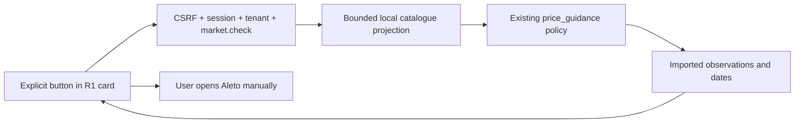

# R5 — On-demand market check (imported-only fallback)

Base: `925237e19325cf70848863b9f3c3570fef9268b4`. Only `/warehouse` changes. No push, deployment, staging migration, catalogue re-import, canonical publish or stock/financial operations.

## Access-policy gate — live refresh BLOCKED

On 2026-10-30, a single access-policy review attempted HTTPS GET `/robots.txt` and `/` at `aleto.ua`. Both failed at this execution environment's outbound tunnel with `403 Forbidden`. This is a proxy restriction, **not evidence that Aleto itself disallows access**. Terms, robots directives, an official API and permission/agreement for programmatic data access could not be verified. No CAPTCHA, login, paid access or anti-bot mechanism was bypassed. No offer pages were scraped and no live refresh is claimed.

The explicitly requested safe alternative is implemented. A user checks the existing imported catalogue, sees original observation dates, can open allowlisted source links, and gets a copyable search phrase plus the Aleto homepage for manual search. A site search URL was not invented. Platform-owner users also get the existing manual-export import link; it never starts an import automatically. Only use exports for which access and use are permitted.

## Audit / reuse

| Existing component | Finding / reuse |
| --- | --- |
| `api/aleto.py`, `services/aleto_catalog.py` | Tenant-local read-only v1 model catalogue; model grouping alone does not establish year compatibility |
| `models/aleto.py`, `services/aleto_import.py` | Offers keyed by account/source/article, OEM, URLs, observation timestamps, model/taxonomy relations; prices retain UAH/USD on one observation; validated additive importer |
| `models/catalogue.py`, catalogue v2 importer | Global offers keyed by source/article, immutable unique offer/time observations, durable explicit import operations, revision and owner-confirmed normalization |
| `price_guidance.py` | Canonical verified mappings/aliases, normalized exact OEM, constructive type/placement, model/year/critical configuration, condition and cosmetic differences; bounded source queries; no inferred OEM |
| Existing confidence | A: >=3 exact comparable ads; B: 1–2 (no median); C: uncertain examples; D: no qualified current evidence. No new price thresholds |
| Existing freshness | 90-day limit; future/missing/zero observations excluded. Imported observations within that limit are still not claimed to be live |
| Existing currencies | Separate cohorts; provider/article deduplicates ads across v1/v2/paths, currency values remain separate; `offer_count` counts unique ads, not currency rows |
| `services/pricing.py`, `models/pricing.py` | Reviewed seller-price commands are separate. R5 never calls preview/apply, `set_price`, stock or audit writers |
| `catalogue_jobs.py` | PostgreSQL durable queue exists for explicit global import commands. Not reused for a synchronous read-only check; no new in-memory or durable jobs |
| R1 / `MarketPricing.tsx` | Shared card receives one new section. `SellerPriceEditor`, existing own-price PATCH/idempotency and UI-1 tokens remain unchanged |

The only optional extension to the existing guidance projection is `include_historical=True`: relevant old observations can be returned as **historical examples**, never as a cohort or recommendation. Ordinary guidance responses and thresholds remain unchanged. Missing/stale canonical publication is still fail-closed. Uncertain compatibility remains outside the verified cohort; condition, side, generation and configuration conflicts are not converted into equivalents.

## Architecture / API

`POST /api/v1/parts/{id}/market-refresh`, JSON `{}` only. Extra fields (including arbitrary URLs) are rejected. Response is synchronous:

- `mode: imported_catalogue`; `status: completed | no_matches`.
- `fresh_data_fetched: false`, `live_refresh_available: false`, `source_status: source_unavailable` with explanation.
- `checked_at`: time the local copy was checked, **not** an observation time.
- `observed_at`: latest actual price-observation timestamp among the displayed allowlisted examples; null if none. It is explicitly labelled “among displayed”.
- `guidance`: reused A/B/C/D projection; `offers`: bounded current/uncertain/historical examples with source/article, amount, currency, original URL/date and limitations.
- `offer_count`: distinct provider/article among displayed ads, excluding duplicate currency rows.
- `context_token`: hash of workspace, current Part/donor parameters and guidance evidence. OEM, configuration, price observation or catalogue revision changes invalidate it.
- `part_revision`, `cached: false`, fixed `external_url: https://aleto.ua/`, and plain `search_text`.

No job ID or `GET /market-refresh/{job_id}` is invented. There are no queued/running jobs, restart recovery claims or newly fetched observations. Restart simply ends an interrupted read; explicitly repeat the read safely. A database failure/statement timeout returns a sanitized 503 and does not erase earlier UI results or observations.

## Permissions / request safety / caching

- Existing `inventory.view` + `catalog.view` still protect market reading. The explicit button additionally requires new server right **`market.check`**. Directors get it through existing effective-role policy; employees need an explicit grant through the existing Team permission mechanism. It is not added to employee defaults. No roles or stored grants are changed by startup/migration.
- Part and source-v1 access remain workspace-scoped. No account/actor is accepted from the client. Global v2 is intentionally shared read-only; results use only the caller's donor context.
- This build performs **zero outbound source requests**. Thus SSRF, redirect-following, external response-size limits, source concurrency/retry/backoff and source cooldown cannot be bypassed: no HTTP client or URL input exists. HTTPS Aleto links are allowlisted to `aleto.ua` / `www.aleto.ua`, port 443/default, no userinfo. If returned evidence links fail this rule, its aggregate is suppressed instead of recomputing a misleading median from a subset.
- One part per request. PostgreSQL projection has a 5-second statement timeout, the existing 20k-source-row bound/truncation policy and bounded returned examples. UI prevents duplicate in-flight clicks and ignores results for an abandoned/changed part or donor context.
- There is **no persistent result cache and no fake cached/live state**: each explicit check recomputes the local projection, so new imports or changed critical attributes do not wait 24 hours. The proposed 24-hour external cooldown is not implemented because external fetching is disabled. It is a prerequisite of a future separately authorized live integration, along with provider permission/API, durable operations, leases/recovery, quotas, HTTPS/SSRF/redirect/size/time limits and immutable observation insertion. No feature flag silently enables live fetching in this commit.

## Verification

Synthetic local PostgreSQL only; no Aleto traffic in automated tests.

- Combined PostgreSQL run: **72 passed** in 140.97s (`test_market_check.py`, `test_stage3c.py`, `test_orders.py`, `test_sales_center.py`).
- R5: 14 tests — exact/dual-currency imported projection and distinct ad count, historical exclusion, context invalidation, repeat/concurrent reads, full-table immutability, CSRF, explicit permission grant/denial, tenant scope, URL/body rejection and aggregate suppression for non-Aleto links.
- Existing Stage 3C suite: 33 cases covering OEM/no OEM/unknown OEM, incompatible side/model/year/engine/variants/condition, new/used/damaged, dated/missing/future/zero prices, deduplication, immutable history, thresholds and seller-price safety.
- Existing R3/R4 backend suites: 25 cases covering journal actors/access and atomic orders/replay/stock concurrency.
- Frontend: TypeScript/Vite build passed; full unit suite 447 passed.
- Browser: 1440/1280/1000/900/768/390/375px against the isolated local `warehouse_r1_test` fixture. Checks explicit loading/disabled button, actual imported-only API, source-unavailable explanation, timestamps, safe manual link, 503 preserving previous results, retry, no JS errors/overflow, unchanged Part before/after, and read-only R3 center/R4 composer navigation. No order creation/confirmation.
- Local JSON fixture `frontend/tests/fixtures/r5-market-check.json` additionally checks source rows, dates, UAH/USD and one ad counted once. These are synthetic ads with deliberately non-real fixture URLs; links are inspected, never fetched. They are not real Aleto observations.
- R1 browser regression passed at 1440/1280/900/768/390/375px.
- Live HTML parsing, source timeouts/redirects, live-cache cooldown, worker crash/recovery and live freshness: **NOT IMPLEMENTED / NOT VERIFIED**, because access-policy gate did not pass. There is no parser to test with captured live HTML.

Evidence logs stay in `/tmp/r5-*`; all-width screenshots/results in `/workspace/scratch/r5`. Browser screenshots below show synthetic local data; fixture-backed offer screenshots are explicitly labelled.

- [Desktop local check](check-desktop.png)
- [iPhone local check](check-mobile.png)
- [Desktop offer-rendering fixture](offers-fixture-desktop.png)
- [iPhone offer-rendering fixture](offers-fixture-mobile.png)

## Release / limitations

No new migration; Alembic head remains `b7e14d90c2f6`. No historical offer/price, Part, selling currency, stock, sales/order, audit or financial write occurs in the check. No catalogue importer or source worker runs on card opening/startup.

Live refresh remains blocked until provider access terms/API/agreement are verified. This release supplies honest local historical information, not current-site availability or market-wide coverage. Cosmetic/configuration uncertainty retains the existing conservative guidance limitations. The manual-search phrase does not establish compatibility, installed quantity or condition. No new source URLs, OEM or prices are inferred.

A later staging release requires separate authorization, normal fast-forward Git checks, API/Web SHA verification and read-only card/permission checks. Do not run an import, sell an order, modify a real price or perform stock operations for acceptance.
