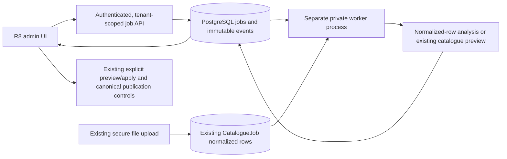

# R8.2 — Durable Cloud Analysis Runner

Base: `17706970787c4763b2c49e89521839d05fbfca5c`, feature branch, `/warehouse` only. This implements PostgreSQL-backed **analysis jobs**, not online source collection. Railway service creation/deployment, Git push, staging migration and production access were not performed.

## Audit / component reuse

| Existing component | Reuse / boundary |
| --- | --- |
| R8.1 admin page | Existing route, owner allowlist, UI-1 design, KPIs, file import, preview/apply and separate canonical publication remain |
| Secure upload / `catalogue_format.py` | Original format/schema/ZIP/SQLite checks remain at upload. Input 16 MiB, expanded 64 MiB, <=50k rows, ratio <=100, manifest/hash/path protections |
| `CatalogueJob` | Existing PostgreSQL-persisted normalized rows, payload SHA, owner, manual resolutions and original file SHA are the durable input. New jobs only reference this record; raw file bytes are not copied into job JSON |
| `catalogue_import.preview` / Planner | Same dry-run engine/savepoint and token generation, no second importer or pricing algorithm. Preview metadata can be saved to the existing upload; global catalogue mutations roll back |
| `catalogue_operations`, canonical runs | Existing workflows retained for compatibility. The new worker does NOT claim/apply those commands. Preview writers share the existing catalogue advisory lock |
| Administrative audit | New append-only events with sequence/time/command key supplement existing actor-owned file/canonical history. New-job history is not called parser collection history |
| RBAC | Existing active platform-owner DIRECTOR allowlist and valid API session/CSRF, not a new administrative bypass. Jobs/results/events/uploads are scoped to the real account/actor |
| Runtime | Python 3.11/Linux and existing hashed requirements lock. No Redis, Celery, FastAPI BackgroundTasks, new dependencies or in-API execution of new jobs |

### Parser archive audit: unavailable

`aleto_parser_source_for_codex.zip` was not present in accessible attachments/workspace/temp files. No unrelated parser was substituted. Its dependencies, SQLite schema, CSV columns, restart/pagination/extraction behavior and Linux compatibility are **UNVERIFIED**. A Windows `.venv`, large databases, full CSV datasets or secrets were not copied into git.

R8.3 needs the actual parser modules, redacted configuration, README, requirements/lockfile, SQLite schema, a small sanitized CSV sample and tests/HTML or JSON fixtures. No live Aleto/Avto.pro access, adapter/model coverage or approved collection permission is claimed.

## Supported jobs and storage limitation

1. **`file_validation`** — checks persisted normalized rows with the existing `ImportRow` schema, including explicit allowance for the uploader's trusted legacy provenance/review metadata. Counts source/article identities, rows, explicit OEM, UAH/USD presence, exact duplicates of normalized rows and errors. One dual-currency ad remains one offer. Results include `validation_scope=persisted_normalized_rows_not_original_bytes`, `committed=false`, bounded diagnostic codes. This is schema/data analysis, not canonical approval or donor fitment proof.
2. **`catalogue_preview`** — runs the existing preview. Returns planned insert/update/unchanged counts, unresolved mappings, skipped rows, exact repeated-row count, conflicts when the full issue set is available (otherwise unknown), source job ID/token and `committed=false`. Unchanged entities are not relabelled as duplicates. No apply or canonical publish type exists.

**Raw-file storage blocker:** original CSV/ZIP/SQLite bytes are not durably retained by the existing uploader and no shared object store is configured. Thus re-reading the original archive or validating its byte-level format after a container restart is not implemented. The supported subset is the already securely uploaded, hash-verified, persisted normalized data. Its PostgreSQL storage survives restarts; the worker never depends on `/tmp`, an API container filesystem or a hypothetical Railway volume. No large CSV/ZIP is stored in the new parameters/result JSON. No artifact table was needed for this subset.

A future raw-file workflow needs a private durable object store, immutable object version/hash/size metadata, scoped downloads and bounded revalidation. It is not silently simulated here. Missing/deleted/changed input gives a controlled failure and does not delete earlier observations.

## Architecture / persistence

New additive tables:

- `import_jobs`: id, account/creator, fixed source `file`, supported type, small reference parameters (upload ID, payload SHA, frozen manual resolutions), status, DB-clock timestamps, actual phase/current/nullable total, bounded result summary, sanitized error code/message, lease owner/expiry, attempt/retry/event counters, idempotency key/fingerprint/context hash.
- `import_job_events`: job ID, unique monotonic sequence, type/message/time, bounded metadata and optional unique command request key. PostgreSQL trigger rejects UPDATE/DELETE of events. There is no public delete endpoint.

Constraints enforce finite supported types/statuses, attempt/retry limits, valid progress and a lease on running jobs. Unique `(account_id,idempotency_key)` persists creation replay. A partial unique index prevents two active jobs for the same owner/context. History responses defer large frozen resolution payloads; private detail projects only input ID/hash. Events/results are paginated and no lease token is returned.

## Lifecycle, leases and recovery

- States: `queued -> running -> completed|failed|cancelled`; explicit retry requeues a failed/cancelled job. Completed means **analysis/preview completed**, never catalogue applied.
- Claim: `FOR UPDATE SKIP LOCKED`, persisted random lease token, attempt increment. Two PostgreSQL session-lock slots bound concurrent executors across replicas. Each execution also owns a per-job session advisory lock on its actual execution connection.
- Heartbeat every 5 seconds; 30-second lease using PostgreSQL clock. Progress is updated at bounded checkpoints and records actual rows/groups, not invented percentages. Lease renewal requires current token, unexpired running state and still-valid actor authorization.
- The execution connection remains fenced even if the heartbeat stalls. Recovery will not take a still-live per-job execution lock merely because its lease expired. The old worker must fail its final token/state/expiry fence and roll back before another execution may claim.
- Process/connection death releases PostgreSQL locks. A new worker sees expired leases, recovers/requeues them, and retries at most three execution attempts. Recovery processes bounded batches. No infinite automatic retry. A fresh execution resets its phase counters.
- Finalization locks the job row, refreshes current state, checks lease/token/deadline/actor again and commits job completion/event **in the same transaction as preview metadata**. Crash after commit is completed; crash before commit is recovered. A previous worker cannot finish a cancelled/reassigned job.
- Cancellation is immediate durable state plus lease fencing, not thread killing. Checkpoints/heartbeat/final fence abort processing. Preview metadata and speculative data roll back. A cancellation racing completion either wins before final commit or receives a completed-state conflict.
- SIGTERM/SIGINT request cooperative shutdown/requeue within the attempt budget. SIGKILL is handled through lease expiry. Worker code is known bounded analysis code, not arbitrary plugins. SQL statement budget 300s, lock timeout 3s and cooperative total runtime budget 300s; these are not a promise to forcibly terminate arbitrary uncooperative third-party Python.
- Explicit retries have a separate persisted limit of three. Cancel/retry keys are stored on immutable events, so a late retry of an old cancel command cannot cancel a later attempt, and a lost retry response cannot consume another retry. Owner submit locks/quota checks serialize new commands.

Creator authorization is checked at execution, heartbeat and final commit, including active root DIRECTOR/allowlist and mandatory-password-change state. The final check uses a short account lock; it does not hold an account lock throughout long analysis. Browser-session expiry/logout is not itself cancellation of an already authorized durable task; use cancel or revoke the actor/allowlist. No browser connection or in-memory job object is required for execution.

## API / permissions / quotas

All routes use the **same existing platform-owner Admin dependency** and server-derived account. View/run/cancel/retry/results are each gated; ordinary workspace directors, employees, `catalog.import` alone and client-supplied actor/account fields do not grant access. Even two allowlisted root owners cannot read or mutate each other's new job/input/event records.

| API | Contract |
| --- | --- |
| `POST /api/v1/admin/import-jobs` | `{catalogue_job_id, job_type: file_validation|catalogue_preview, request_key: UUID}` -> 201 durable job or exact replay; no raw file, URL or executable code |
| `GET /api/v1/admin/import-jobs` | Account-scoped history, limit 50/default/max100, bounded offset; no large resolutions in history |
| `GET /api/v1/admin/import-jobs/inputs` | Latest 100 own nonfailed uploads; no file rows returned |
| `GET /api/v1/admin/import-jobs/{id}` | Scoped status, actual progress, bounded summary/errors; sanitized input metadata |
| `GET /api/v1/admin/import-jobs/{id}/events` | Scoped, sequence-ordered, paginated immutable events; no lease/session secrets |
| `POST /api/v1/admin/import-jobs/{id}/cancel` | `{request_key:UUID}`; durable, replay-safe cancellation |
| `POST /api/v1/admin/import-jobs/{id}/retry` | `{request_key:UUID}`; explicit bounded retry of same saved context |

Different bodies cannot reuse a creation key. A different key for an already active context gets 409. Limits: <=2 active tasks/account, <=20 new jobs/account/15 minutes by DB clock, <=2 concurrent executors/database, <=3 execution attempts and <=3 explicit retries/job. New intent after exhaustion still requires a new key and is subject to the account quotas. Unsupported type/extra URL/code/account fields are rejected. Missing/changed input and changed manual resolutions fail closed. Worker error codes/messages are sanitized, never raw SQL/credentials/source bodies.

Existing legacy preview/global catalogue lock is reused. A current completed runner preview is projected truthfully into the existing file view only when its saved preview token still matches and it is newer than an old terminal operation; a newer active legacy operation takes precedence. This prevents an old error/202 state hiding a valid new preview. Read projection is bounded and does not create a fake catalogue operation or alter history. Apply still goes through the existing current-token/revision/confirmation controls.

## UI behavior

R8.1 now has a separate **Безпечні серверні задачі** section: choose own saved input/type, enqueue, poll, restore selection/history, view summaries/events, cancel and retry. Unknown total uses indeterminate progress; displayed counters explicitly describe the current row/group phase. Old detail/events are not presented under a newly selected job ID. Cancel/retry are disabled while the selected status is unconfirmed.

Uncertain commands are persisted per actor/workspace in sessionStorage with their exact path/body/key. No automatic POST on reload. “Перевірити результат команди” explicitly replays the original intent; transient conflict/quota during uncertain replay retains the key. Stored commands cannot reference arbitrary URLs, apply, publication or code. Server idempotency remains authoritative across browsers.

A completed preview offers “Відкрити актуальний preview у імпорті”. This opens the current saved file state, **not** a blind apply of an old token. No queue route performs apply or publication. Aleto online/Avto.pro start stays disabled. Online collection history stays explicitly unavailable; new analysis history is labelled separately. Queueing is allowed before a worker is provisioned, but UI says it is waiting for a worker; code does not fake a connected cloud service.

## Railway preparation — files only, NOT deployed

Prepared `warehouse/deploy/railway/import-worker.Dockerfile` and `import-worker-service.json` (checklist, not applied config). Python lock/dependencies are reused; image runs as nonroot, no HTTP listener/public port, no ephemeral artifact directory dependency. Container build and actual Railway worker runtime are not claimed as verified; local Linux CLI execution is verified.

After separate release/provisioning authorization:

1. Verify the existing isolated `selfless-caring` / `warehouse-staging` environment and Warehouse PostgreSQL connection. Do not touch production worker, Redis, main bot or generic CarPot DB.
2. Deploy matching API/Web code normally. API's existing `app.staging` serializes Alembic under its migration lock. Confirm API health and actual revision **`c8f21d6e903a`** before worker start. New frontend head allowlists include both previous and new head; old Web can fail closed briefly after API migration, so coordinate the two application deployments.
3. Prepare a private service (suggested name `warehouse-import-worker`), repo `TsPa33/telegram-bot`, branch `feature/carpot-warehouse-mvp`, root `/warehouse`, Dockerfile `deploy/railway/import-worker.Dockerfile`, start `python -m app.import_worker`, initially one replica. No public domain or HTTP healthcheck; no file volume required for this supported subset.
4. Bind **the same verified staging Warehouse DB** via `WAREHOUSE_DATABASE_URL` or the complete `WAREHOUSE_DB_HOST/PORT/NAME/USER/PASSWORD` tuple. Do not blindly substitute an unrelated `POSTGRES_DB`; match the API's verified Warehouse database name. Config deliberately ignores generic `DATABASE_URL`.
5. Set `WAREHOUSE_ENV=staging` and the API's server `WAREHOUSE_CATALOG_PLATFORM_ADMIN_IDS` allowlist on the worker through reviewed private references. Secrets/values are not copied into git. No Variables were changed in this task.
6. Worker waits up to 120s for its packaged **single head and job tables**, never calls Alembic. It exits without work if schema is not ready; do not run competing worker migrations. API retains the existing legacy catalogue/canonical worker for old workflows; the new worker handles only the new analysis queue.
7. Review DB role/grants, worker memory and concurrency before provisioning. No new DB role was created here; a restricted worker role must support its metadata locks/preview operations and be tested rather than assumed sufficient. Database environment labels are not proof of infrastructure isolation; verify actual bindings.
8. Only use a dedicated synthetic staging workspace for later write acceptance. Verify enqueue -> closed browser -> completion, cancel/retry/recovery and read-only data preservation. Do not apply/publish/catalogue re-import or perform stock/sale operations for acceptance.

Local runtime: from `warehouse/backend`, `python -m app.import_worker` or `--once`. CLI permits staging configuration or an explicitly loopback database ending `_test`; the ordinary Warehouse DB-prefix guard also applies. No API/worker migration commands were run against staging.

## Migration / data safety

New **single head `c8f21d6e903a`**, parent **`b7e14d90c2f6`**. Only two new tables, indexes/constraints and the new-event immutability function/trigger. No backfill or modification to stock, prices, finance, receipts, sales, old offers or audit tables. No raw-artifact table.

Local tests covered empty upgrade and populated parent -> head upgrade with positive stock, seller prices, a historical sale and imported offer/price data; all old table contents were unchanged. Worker schema check rejects the parent and accepts upgraded schema. Downgrade refuses when runner history exists; do not automatically downgrade or clear history during a failed deployment. Roll forward/redeploy compatible code after inspecting logs.

Tests asserting current Alembic head were updated; historical required base revisions and backend business commands remain unchanged. UI readiness continues accepting the older known head for mixed-version compatibility and adds the new one without accepting arbitrary revisions.

## Verification

- Broad affected backend regression: **207 passed** (`test_import_runner`, parser admin, catalogue queue/import, staging/readiness/migration, orders/sales, R5 checks, Stage 3C, virtual inventory/workshop). No full main-bot tests were run.
- Final focused queue/admin/import-worker regression: **47 passed** after the final refinements; it overlaps the broad run and must not be added as unique cases. Includes legacy provenance, bounded history projection and latest-preview hand-off fixes.
- Backend scenarios include creation/key conflicts, exact replay, account/context quotas, two real concurrent workers, live execution lock with expired lease, heartbeat fencing, real subprocess SIGKILL for validation **and preview**, recovery, bounded retries, controlled shutdown, cancellation after planner returns, role revocation, missing storage, immutable events, tenant/CSRF gates and additive populated migration.
- Frontend build passed; full unit suite **455 passed**, including eight command-recovery validation/error-classification cases.
- Real local browser QA: **1440/1280/1000/900/768/390/375px**, guarded fresh `warehouse_r82_final_test`. Actual separate `python -m app.import_worker --once` process; lost create response replay, reload, page closed before execution, queued cancel, retry, completed validation, real access-revoked worker failure/retry at 390px, catalogue preview and existing-file hand-off. Global catalogue remained empty; no apply, canonical publish, Part/order/sale/finance action or external-site request occurred.
- R8.1 browser regression passed at all seven widths against the new schema, including original file preview and canonical preview/confirmation gate (no apply/publish).
- Original frontend units and backend financial/inventory regressions validate previous R1/R3/R4/R5 behavior. Fixtures and credentials are local/synthetic, not staging evidence. Real Volvo B and the absent parser archive were not tested.

Evidence logs: `/tmp/r82-backend-final.log`, `/tmp/r82-focus-final.log`, `/tmp/r82-build.log`, `/tmp/r82-unit.log`, `/tmp/r82-browser-final.log`, `/tmp/r82-r81-regression.log`. All-width screenshots/results: `/workspace/scratch/r82`. The seed script refuses existing DBs and only accepts explicitly named loopback `warehouse_r82_*_test` databases; it never resets a real database. Process-death tests force lease expiry in the disposable DB after SIGKILL to avoid artificial long waits; the process death itself is real.

- [Desktop](desktop.png)
- [iPhone](mobile.png)

## Known limitations / R8.3

- No actual Railway service, deployment, container-image build or staging migration performed. Prepared files and local CLI are ready for controlled review, not proof of cloud deployment success.
- Full raw-file revalidation/artifact download is blocked on durable private storage. Current validated-row subset is persistent and restart-safe; it is not described as original-byte validation.
- Parser source archive absent. Aleto/Avto.pro network integration and model support remain unverified/disabled. No robots/auth/CAPTCHA/payment restrictions were bypassed.
- Cooperative timeout/cancel checks are for the known bounded analysis/planner code. Do not load arbitrary Python or an unreviewed parser into this process.
- Read history is paginated, latest input selector capped at 100, error examples bounded. Large external artifacts, retention/archival tooling and source-adapter checkpoints remain follow-up work.
- R8.3 must audit the supplied source and permitted access, implement versioned fixture-tested adapters and durable artifact storage, and add provider-specific SSRF/DNS/redirect/size/time/rate controls before any online capability is enabled. No UI switch in this commit activates scraping.
