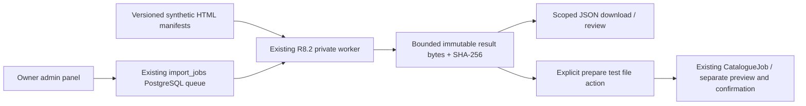

# R8.3 — Aleto source adapter / bounded offline runner

Base `bbfe8acefa645e82d5ec48f5d458bd8d53f36f9e`, branch `feature/carpot-warehouse-mvp`. Only Warehouse changed. No Git push, Railway service creation/deployment/Variables, staging migration, production operations, external collection, global apply or canonical publication performed.

## Source audit and reuse

The supplied file was **`CarPot_Aleto_Parser_Source_R83.zip`** (the request also uses the older `aleto_parser_source_for_codex.zip` name). ZIP SHA-256: `3c810817fbd80102f2bd7131f931dd8219f051e4e692f9f0b42cdaa515948b11`. Its five files were inspected: `parser.py`, README, requirements, configuration and tests. No `.venv`, SQLite database, secrets or real captured HTML was provided. `parser.py` SHA-256: `a98b3972562bffa0166746e651418f0d50f8b7f3a56b73b1d13a256fcbd4d75f`.

| Supplied component | Decision |
| --- | --- |
| `product_candidates()` | Adapted `.detail-item`, title/attribute/price/label selectors, explicit article vs original-number labels and `item_category2/3` keys into network-free `aleto_adapter.py`. No fuzzy matching or canonical normalization changes |
| `extract_page_links`, `extract_category_links` | Reused pagination/category discovery conventions; follow only URLs present in the immutable packaged fixture manifest; never request an unknown page |
| `clean`, `amount` | Same whitespace cleanup; replaced permissive float/character stripping with strict Decimal currency-specific full matching. Invalid/negative/ambiguous prices are errors, never silently repaired |
| `same_site`, `allowed_path`, URL fallback | Replaced with HTTPS/exact-host/credential/port/path/control-character checks. A bad product URL is rejected rather than replaced with the listing URL |
| Volvo configuration | Three explicit model labels and catalogue roots retained. `requested_from` and years in URLs are **not** technical compatibility evidence; no generation/years invented |
| Per-page duplicate removal | Removed so duplicate counts remain observable. Deduplication happens after extraction, while raw extracted observations remain in result JSON. Conflicting article observations are withheld from import, never last-write-wins |
| `Fetcher`, `requests`, robots handling | Not loaded/copied/executed. Automatic access permission is unconfirmed. Original client follows redirects without explicit target/DNS checks and lacks response-byte bounds; it is not an approved network adapter |
| SQLite `save_product`, crawler, CSV export | Not used: they write current execution time as `checked_at`, keep mutable last-seen product state and don't durably checkpoint the remaining queue. Existing R8.2 queue/leases and explicit CatalogueJob hand-off are reused instead |
| Dependencies | No new Python/npm runtime dependency. Extraction uses bounded standard-library `HTMLParser`, so requests/BS4/lxml from the archive are not needed in the worker |
| Archive tests | One card fixture uses `.item`, whereas the implementation searches `.detail-item`. It is not evidence of working live selectors. New offline tests exercise the actual selected markup and explicitly reject unsupported markup |

The original archive was not blindly vendored into the worker. Source-derived selector provenance is recorded here and in the adapter docstring. No FileDbTree integration.

## Modes / supported models

- **Offline fixture: working end-to-end**, Volvo XC40, XC60, XC90, with server-selected roots from the supplied configuration. Three versioned synthetic JSON manifests live under `app/services/aleto_fixtures/`; each has two listing pages and three cards representing two unique synthetic offers and one duplicate. Every manifest/page/row/report is explicitly synthetic. These are not real captures, Volvo A/B tests or measured live coverage.
- **Existing file import: retained**, with separate upload/preview/apply controls. The adapter does not change its deduplication, pricing or normalization engine.
- **Approved/live source: DISABLED**. No verified permission/terms/robots evidence, live requests or production selector/model validation was supplied. There is no request parameter, environment flag or UI switch that activates HTTP in this adapter. Aleto/Avto.pro online controls remain disabled.

URLs in fixture HTML and the configuration are identifiers, not proof of fitment or permission to fetch. `observed_at` is required, timezone-aware and preserved from the fixture's declared synthetic capture time. No current time, file mtime or donor year is substituted. The source namespace for rows is **`aleto-offline-fixture`**, with `data_origin=synthetic_offline_fixture` in preserved string-valued source provenance. Thus synthetic observations cannot silently overwrite the real `aleto` namespace.

## Architecture / lifecycle

New supported queue pair: `source=aleto_fixture`, `job_type=aleto_offline`. Parameters contain only `manufacturer=Volvo`, selected known `model`, adapter/fixture version and exact manifest SHA-256. A changed fixture after enqueue fails closed. No client URLs, HTML, filesystem path, Python code, account ID or online-mode parameter is accepted. Filesystem reads are restricted to the server's hardcoded model manifest filenames.

The same R8.2 creation keys, owner context/active quotas, PostgreSQL `SKIP LOCKED`, per-job advisory execution fence, two executor slots, 30-second lease / 5-second heartbeat, attempt/retry limits, actor revocation checks and final fencing transaction apply. No alternative queue, BackgroundTasks or browser-bound process. Supported code runs in the separate worker, not API request handlers. API owns migrations; the worker waits for the packaged head and never calls Alembic.

Progress counts actual parsed fixture pages with **unknown total**, including cancellation/authorization/time-budget checkpoints between pages. The UI does not display 100% or infer live collection completeness. A finished task reports `fixture_pages_complete` only when all manifest pages were visited and there are no errors; otherwise `partial_fixture`. `live_collection_completeness` is always `unverified`.

**Recovery:** the small immutable fixture is replayed from its beginning after a process death. There is no claimed resumable live crawl cursor. An in-flight artifact rolls back with job completion on cancellation/SIGKILL/final-fence failure; lease recovery requeues within the existing bounded attempt budget. Commit includes the artifact plus final status/event atomically. One artifact per job, completed tasks cannot be retried. A genuinely new run keeps separate job history; repeated explicit hand-off reuses the same actor-owned content-identical upload.

## Result / durable storage boundary

`import_job_artifacts` holds the **small offline result bytes** (PostgreSQL BYTEA), content SHA-256, exact byte count, creation time and optional prepared-upload reference. Maximum **1 MiB** per artifact is checked in application code and DB constraint; content/hash/job identity are immutable via trigger. Artifacts are never stored in generic job parameters/results JSON. The result contains bounded raw extracted records, v2-compatible rows, fixture checksum, counts and bounded diagnostics. A checksum is revalidated before download and before preparing an import.

Reports show pages checked, raw card count, unique extracted articles, exportable unique offers, offers with prices/OEM, identical duplicates, conflicts, errors, skipped invalid/conflicted records, source mode, version and completeness. With-prices/OEM counts refer to exportable offers; the raw records and diagnostics explain exclusions. Missing category/subcategory is an error, not a guessed label. Duplicate raw observations are retained even when identical rows collapse. Conflicting article identity/OEM/price/time/condition/title or URL prevents exporting that article. Distinct category/model associations are preserved when nonconflicting. Prices remain original UAH/USD Decimal strings without conversion. Run start/finish timestamps are queue metadata separate from observation time.

No raw HTML/CSV/ZIP is accepted through the new create endpoint. HTML is at most 256 KiB/page, 8 pages/fixture, 500 extracted records, 10k HTML nodes/depth 64 and 1 MiB output. Standard uploader size/ZIP protections remain unchanged.

**Large storage blocker:** no private object store is configured. Large raw files, large crawler results, artifact retention/download and safe resume of a live crawl are NOT implemented. A >1 MiB result fails with `ARTIFACT_STORAGE_LIMIT`, without partial publication. A future approved source needs private durable object storage and immutable version/size/hash metadata; neither API nor worker ephemeral disk is an artifact store. Database storage is only for this deliberately small offline subset.

## API / permissions

All routes use current platform-owner server allowlist + active root DIRECTOR, session/CSRF and server-derived account. New result data is strictly scoped even across two allowlisted owners. No new permission bypass. Original global-catalogue confirmation/publish gates remain unchanged.

- `POST /api/v1/admin/import-jobs`: `{job_type:"aleto_offline", manufacturer:"Volvo", model:"XC60", request_key:"<UUID>"}`. Same endpoint still accepts the original saved-file job types.
- Existing list/detail/events/cancel/retry APIs: same contracts/statuses, small sanitized parameters on detail. No artifact bodies in history. Error codes are bounded/sanitized, never SQL/credentials/raw HTML.
- `GET /api/v1/admin/import-jobs/{id}/result`: authenticated owner-only attachment JSON, `Cache-Control: private, no-store`, `X-Content-SHA256`, `nosniff`. Only completed adapter jobs with intact artifacts.
- `POST /api/v1/admin/import-jobs/{id}/result/import`: CSRF/owner gated, `{request_key:"<UUID>"}`. Explicitly prepares **a synthetic test file**, idempotent under the existing actor submit lock plus job row lock. Same result/owner/hash reuses an existing upload even across repeated runs. No preview/apply/publish executed. No upload → no hand-off for an empty result.

The UI adds “Тестовий offline-парсер Aleto” next to the two saved-file analyses, with a known brand/model selection. It shows queued/running/terminal state, durable history, page progress, timestamps/source/completeness, JSON download and a distinct prepare-test-file action. Reload/closed browser does not cancel work. Uncertain command recovery accepts only these exact command shapes, never arbitrary URLs or apply. Results are **not** labelled live market data.

## Migration and deployment preparation

Single new head **`d3a82f1c904b`**, parent **`c8f21d6e903a`**. Adds only `import_job_artifacts`, its constraints/immutability trigger/function, and widens the existing runner type check to allow the new explicit source/type pair. Existing columns and jobs are preserved. No stock/finance/catalogue schema change or backfill. Downgrade refuses if adapter history/results exist; no automatic downgrade/cleanup.

R8.2 Dockerfile already copies the app (including fixtures), so no dependency/start command change is required. Future controlled release order: API migration/startup -> Web -> same-SHA worker, `python -m app.import_worker`. Worker requires the matching new head and the same verified isolated Warehouse staging DB + platform-owner allowlist. Until separately provisioned it is not a functioning Railway service. Old R8.2 worker will not claim the new type. No Railway service/Variables/branch bindings were created or changed here. Image build/cloud runtime remain unverified.

## Local verification

Affected backend regression: **146 passed**; final adapter/runner regression after the last URL/error refinements: **51 passed** (overlapping suites, not summed). Frontend build **PASS**, full unit suite **458 passed**. Offline adapter browser QA and R8.1 browser regression each passed all seven widths. All DB tests use dedicated loopback `warehouse_r83_*_test` databases and synthetic owners, never real staging/Volvo donors. No live site requests, apply, canonical publish, Part/receipt, sale/financial commands were performed during browser acceptance. Financial/inventory regression fixtures stay local and disposable.

- Backend extraction, unsafe URLs, invalid/missing prices, missing OEM, broken/unsupported HTML and limits; fixture checksum/partial coverage/conflicts; durable artifact/explicit idempotent hand-off; original preview engine without apply; tenant/CSRF/RBAC; cancel after artifact flush, worker shutdown/retry, SIGKILL+restart recovery and migration/data preservation.
- Frontend build, full frontend unit suite and command-recovery regression.
- Local browser widths: 1440/1280/1000/900/768/390/375px. Actual independent worker CLI, browser close/reload, mobile cancel/retry, checksummed result download, explicit file preparation, no live request/apply, no JS errors/overflow. Existing R8.1 seven-width browser regression retained separately.

Evidence logs: `/tmp/r83-backend-final.log`, `/tmp/r83-focus-final.log`, `/tmp/r83-build-final.log`, `/tmp/r83-unit-final.log`, `/tmp/r83-browser-final.log`, `/tmp/r83-r81-browser.log`. All-width screenshots/results are under `/workspace/scratch/r83`. The tests simulate lease expiry only in disposable databases after real child-process SIGKILL, to avoid artificial waits. One known Starlette/httpx deprecation warning remains; it is unrelated to adapter functionality.

Screenshots: [Desktop](desktop.png), [Mobile](mobile.png).

## Blockers / next authorized steps

1. Obtain and review the permitted live Aleto access method. No claim of robots/terms authorization or working live selectors.
2. Audit redirects, DNS/IP resolution, per-response/total bytes, URL scope, robots policy, rate/retry handling and approved-source fixtures before any network adapter.
3. Provision reviewed private object storage for large artifacts and safe crawl checkpoints.
4. Separately authorize any push/deployment/migration/worker provisioning, then verify cloud lifecycle and health using an explicitly synthetic workspace.
5. Keep final import and canonical publication separate; no automatic donor/stock/price/finance changes. Do not add FileDbTree in this stage.
