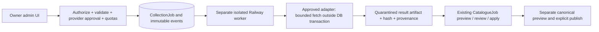

# R8.1 — Parser Administration Center

Base `1053af972a61430b6ddcc8c29df5e455756f823b`, feature branch, `/warehouse` only. R8.1 is a functional administration UI over existing file-import and canonical-governance workflows. It does **not** collect source pages or provision a worker.

## 1. Parser archive audit: BLOCKED (archive absent)

`aleto_parser_mvp(1).zip` was not found in attachments, repository or available workspace/temp files. The old `carpot_aleto_staging_package.zip` is a different prepared-data package, not the requested parser source. No substitute parser was downloaded or invented.

The user's description says the missing archive contains a Windows `.venv`, SQLite and a large CSV; these contents were **not independently inspected**. Consequently page fetching, pagination, title/OEM/article/condition/price extraction, persistence/checkpoints/resume, Linux dependency compatibility and actual supported models remain UNVERIFIED.

For the next audit, supply these specific artifacts, without credentials or large duplicated data:

| Needed | Purpose |
| --- | --- |
| `parser.py` and its imported local modules | Fetch, pagination, extraction, retry/resume behavior |
| Redacted `config.json` | Real selectors, supported model configuration and limits; remove tokens/passwords/cookies |
| `README.md`, `requirements.txt` or lockfile | Invocation, Python/platform assumptions and pinned Linux dependencies |
| SQLite schema dump (`CREATE TABLE`/indexes) + tiny sanitized sample | Identity, observations, checkpoints, uniqueness, crash recovery |
| CSV header and small sanitized representative rows | Lossless mapping of source article vs OEM, currencies, provenance and observation time |
| Existing tests and small HTML/JSON fixtures | Regression of parsing without source traffic |

Do not send/copy Windows `.venv`, `__pycache__`, browser sessions, local secrets or full repeated SQLite/CSV datasets into git. None were added by R8.1. Archive absence blocks adapter/runner verification, **not** use of existing Warehouse file import.

## 2. Warehouse audit

| Existing mechanism | Verified behavior / reuse |
| --- | --- |
| `api/aleto.py`, `models/aleto.py`, `aleto_catalog.py` | Tenant-local Volvo v1 reference offers/prices/model paths. Source article and OEM are separate. Model grouping is not year/fitment proof |
| `aleto_import.py`, `catalogue_format.py` | Validated additive package/file import; original price timestamps; separate original UAH/USD values, one ad identity |
| `catalogue_convert.py` | Existing offline lossless parser-CSV-to-v2 converter. Its known raw-CSV model mappings are Volvo XC40/XC60/XC90. The absent parser's actual CSV has not been checked against it |
| `api/catalogue.py`, `catalogue_import.py` | Uploaded jobs, SHA-256, normalized payload, dry-run/preview, manual resolutions, report, explicit matching preview-token apply, idempotent offers/observations |
| `catalogue_jobs.py` | Durable PostgreSQL operations, duplicate enqueue protection, one coordinated worker, progress phases and transaction rollback. Interrupted running work is exposed as controlled error; explicit retry |
| `api/canonical.py`, `canonical_jobs.py` | Separate durable normalization preview and owner-confirmed publication. Stale source/token/rules prevent unsafe publication. Exact group review remains available |
| `CanonicalCatalogueAdmin.tsx` | Existing diagnostics, review/groups, normalization, publication checkbox/token, reload/recovery; retained in the page |
| `api/pricing.py`, `price_guidance.py`, R5/R5.1 | Imported-only price checks. No permitted live access/runner. No automatic seller-price update. R8.1 changes neither matching nor price algorithms |
| RBAC | Global administration requires active platform-owner DIRECTOR on the server allowlist, root account (not an employee workspace), current valid session. Ordinary DIRECTOR/ADMIN, `catalog.import` alone and client-enabled UI cannot bypass it |
| Administrative audit | Existing jobs/operations/runs/rules preserve actor IDs, request/preview evidence, status, times and errors. Rejected uploads keep rejection metadata. This is not a new universal append-only admin event ledger; future runner events are designed below |

File limits remain the existing ones: 16 MiB input, 64 MiB expanded, compression ratio <=100, <=50k normalized rows. ZIP accepts only a root manifest plus one root CSV, checks SHA-256, rejects encrypted/symlink/path entries, and is not extracted into arbitrary paths. SQLite is read-only/query-only and rejects unexpected tables/views/triggers. No Windows environment or untrusted code is executed.

## 3. Implemented capability matrix

| Capability | R8.1 state |
| --- | --- |
| Real KPI overview | Implemented, owner-only API |
| Aleto file/package import | Existing workflow retained |
| CSV / permitted v2 ZIP export | Existing workflow retained |
| Aleto online API/web runner | NOT CONNECTED; no launch button action |
| Avto.pro adapter/runner | NOT CONNECTED |
| Syntax validation of collection parameters | Implemented; always `runnable=false`; no fitment/source-support claim |
| Current import/canonical operation | Actual durable active status, counters only where available |
| Result/manual mapping/apply | Existing report, draft recovery, token and explicit confirmation retained |
| Constructive normalization/publication | Separate existing workflow retained; no automatic publish |
| File-import history | Existing durable history, now paginated at 50 with timestamps and Ukrainian status labels |
| Online collection history | Explicit empty/unavailable state; no parser-job table exists yet |
| Cloud task/adapter/event schema | Design only for R8.2–R8.5, not deployed/migrated |

KPI definitions are intentionally narrow:

- “Підключені джерела” counts **sources in the imported global catalogue**, not online adapters; the card explicitly says so. Exact count is separate from the bounded 100-name list.
- “Останній імпорт” is the latest **applied** file job, not upload, preview or canonical publication.
- “Активні завдання” counts queued/running import operations plus canonical runs; these are **not collection jobs**.
- “Оновлені цінові спостереження” is the last applied job's reported inserted price-observation count. Missing metadata is “Немає даних”, never guessed as zero.
- Global counts with OEM/prices describe the current imported catalogue. Two currency fields on one current observation count as one priced offer. They do not describe a running preview.
- Current-task progress is **offer groups in the planning phase**, not a whole-job completion percentage. Unknown totals/normalization phases use indeterminate progress. Valid-record/model counters are unknown when not persisted.
- File-preview counts remain the existing report. Missing duplicate/OEM input counters explicitly show “Немає даних”; unchanged rows are not relabelled as duplicates. Skipped rows are not called invalid products.

## 4. UI and API

The existing `/administration/catalogue/import` route now has one page title, four compact KPI cards, left parameter form/right actual-task panel, file import/review/results, file history, separate canonical governance and finally an explicit empty **online collection history**. Uses UI-1 tokens and the existing dark sidebar; no navigation/auth rewrite or second theme. Technical file hashes/IDs stay in disclosure. Errors stay visible, stored failed-upload error is shown, and manual drafts/polling/apply protection remain intact.

New APIs (existing admin gate, no schema change):

- `GET /api/v1/catalogue/admin/overview`: exact source count, bounded source names, truthful disabled capability registry, latest applied import, its inserted price count, active operation count and latest active import/canonical operation, current global offer/OEM/price counts, `collection_history_available=false`, `online_collection_enabled=false`. Returns no rows payload, session hash or command secrets. Uses a 5-second transaction-local statement timeout; DB failure gives sanitized 503.
- `POST /api/v1/catalogue/admin/parser/validate`: `{source: aleto|avtopro|file, manufacturer, model, year_from?, year_to?, collect: [names|oem|prices|categories]}`. Extra fields/URLs/actor IDs are rejected. Server validates lengths, integer year bounds/order, required online selectors, unique nonempty collection fields. Returns `{valid:true,runnable:false,parameters,message}`. Does not enqueue/store a collection task, fetch data or validate external model availability.

Validation reuses the existing process-local auth throttle (20 attempts/15 minutes per real owner, separate namespace). This protects the small validation endpoint; **it is not a distributed cloud-runner quota**. Active-state polling is not put behind that submission throttle. All source-network concurrency/rate is zero because no collection capability is enabled. UI disables duplicate validation while pending and ignores stale responses after parameter changes.

Existing `POST /catalogue/admin/jobs`, preview/apply, canonical runs and group/rule APIs stay unchanged. Mutations retain CSRF, owner reauthorization, locks, server-validated payloads and their original preview/confirm gates. No “start collection” endpoint or fake job UUID was added.

## 5. R8.2 design — durable Cloud Runner (NOT implemented)



Proposed additive tables, only after a separately reviewed migration:

- `collection_jobs`: UUID, actor/workspace scope, catalogue-global/private scope, source ID, normalized selector, exact capability/approval revision, request key + body fingerprint, context hash, status, created/started/finished timestamps, attempt, worker ID, lease/fencing token and expiry, heartbeat, safe checkpoint, cancellation request, actual page/byte/offer counters, nullable known total, immutable result hash/artifact reference, structured sanitized failure.
- `collection_job_events`: append-only job/sequence ID, event time/type, initiating actor or worker, phase/counters/diagnostic code. No API secrets/cookies/full HTML in logs. Unique `(job_id,sequence)` prevents replay duplicates; actor information remains real, never replaced with a current owner.

Lifecycle: `queued -> running -> completed|failed|cancelled`. Completed means staged output exists, **not** that it is imported/published. Transactional `SKIP LOCKED` claim, lease heartbeat (e.g. 15s/90s expiry, to tune through testing), monotonically increasing fencing token. Writes/checkpoints require current lease and running status. Expired work is failed/requeued only when adapter declares checkpoint replay safe; bounded attempts and explicit visible recovery. Old workers cannot commit after reassignment. Check cancellation between fetches and before final artifact commit; cancellation never undoes a published catalogue implicitly.

Durable uniqueness: `(scope,actor,request_key)` with exact body fingerprint, plus only one active job per permitted source/context where appropriate. Re-authorize at enqueue and before materialization/import. Acquire no DB transaction across HTTP. At-least-once delivery must not imply duplicate observations: use provider/article plus actual observed timestamp, both currency fields together, conflict review rather than historical UPDATE. Source article is never an inferred OEM.

Initial proposed quotas: one collection per source, at most two workers globally; max 20 pages / 15 minutes / 50 MiB / 5k offers per explicitly confirmed small job, subject to a **stricter provider-approved** rate. These are a design starting point, not current configured or provider-authorized limits. Persist per-source/workspace quotas and retry-after/backoff with jitter, maximum attempts, capped response sizes and no retry of disallowed/auth/CAPTCHA pages. Unknown page count stays null, not a fake percentage.

Separate Railway worker in the **same isolated Warehouse environment** is preferable for CPU/network isolation and independent restart/drain behavior. Use a restricted DB role/artifact store and tightly scoped provider credentials; worker has no reason to update Part, receipts, sales or finance. No Railway service/Variables/root/watch settings were created or changed in R8.1. No Redis/Celery is required merely to implement a PostgreSQL claim/lease queue. Never reuse the catalogue-import queue as an arbitrary HTTP executor.

Results should be bounded, hash-checked artifacts (JSONL/v2-compatible CSV/ZIP plus original fields/provenance), private by scope with TTL/storage budget and safe authenticated download. No arbitrary client-supplied artifact/fetch URL. Audited explicit hand-off to the existing importer; it still needs preview and apply. Retain old observations on failure.

## 6. R8.3 design — Source Adapter contract (NOT implemented)

An adapter exposes **separate** `file_import`, `approved_api` and `approved_web_collection` capabilities, selector schema, genuinely fixture-tested models, permitted endpoints/domain/approval record, fetch/parse versions and supported checkpoints. Robots permits do not constitute legal permission. Approval expiry or robots/auth/anti-bot restrictions disable the relevant capability, not redirect it to an alternate URL/proxy/User-Agent.

Suggested interface:

```text
validate_selector(source_id, manufacturer, model, year_range?, region?)
fetch_batch(selector, checkpoint, approved_limits, cancellation) -> bounded bytes + actual response metadata
parse_batch(bytes, schema_version) -> NormalizedOffer[] + diagnostics + next_checkpoint
```

Normalized offer must preserve `source_id`, original `source_article`, original product title, source HTTPS URL, manufacturer/model and evidenced year/configuration fields, OEM separately (raw + normalized), condition, categories, side/position, original UAH/USD amounts on one ad, actual `observed_at`, adapter/parser version, source-record hash and raw nonsecret fields. Unknown data remains unknown. Keep `fetched_at`/`imported_at` separate; never replace the original observation date with upload time.

Enforce HTTPS/domain/port/DNS/IP SSRF restrictions, redirect policy on every hop, response/expansion/time limits, safe retries and no arbitrary client URLs **before enabling any web adapter**. Use local redacted HTML/JSON fixtures for parsing tests. No BMW or other model support is claimed from a generic text selector. Aleto online capabilities remain disabled until access is verified; Avto.pro has no adapter here.

## 7. R8.2–R8.5 delivery plan

| Stage | Deliverable / release gate |
| --- | --- |
| R8.2 | Reviewed additive job/event schema, durable claim/lease/fencing/cancel/status API, quotas; worker only against local fixture adapter; crash/concurrency tests |
| R8.3 | Audit the supplied parser source and approved access; implement isolated versioned adapters and fixture tests; online capability stays disabled without permission |
| R8.4 | Lossless artifacts -> existing v2 upload/preview/review/apply; immutable observation dedup, exact provenance/currency checks, manual canonical normalization/publication |
| R8.5 | End-to-end admin events/history, operational telemetry, resource/rate budgets, controlled staging worker acceptance and cancellation/restart tests; live mode only after explicit verified provider access |

## 8. Tests / evidence

- Combined PostgreSQL run: **55 passed** in 75.10s (`test_parser_admin.py`, `test_catalogue_jobs.py`, `test_canonical_v3.py`), including 16 R8.1 cases.
- Targeted R8.1 PostgreSQL tests cover empty and populated statistics, real import progress, indeterminate canonical progress, immutable full-table snapshots, syntax validation without socket access, invalid parameters/URLs, absent allowlist, foreign director/employee denial, CSRF and submission throttle.
- Queue/canonical regression uses existing disposable test DB and explicit workers, never staging. New APIs do not mutate stock, finance, canonical state or job state.
- Full frontend unit suite: 447 passed. TypeScript/Vite build passed.
- Browser QA at 1440/1280/1000/900/768/390/375px on a **new isolated** `warehouse_r81_test`, seeded by the guarded `frontend/tests/seed-r81.py`. Tests actual form/server validation, disabled sources/run button, empty parser history, keyboard focus, failure/retry of overview, ordinary reader denial, and no JS errors/overflow. Synthetic CSV is uploaded and previewed; canonical normalization is previewed. Apply/publish buttons are checked for explicit confirmation but **not invoked** by this browser suite.
- Existing catalogue-review browser regression passed at 1440/390px: six manual decisions, stale 202, polling/reload, API failure/504, explicit retry and stale-apply guard; no apply.
- R1 browser regression: six widths passed. R5/R5.1 browser regression: seven widths passed, including read-only R3 center/R4 composer navigation; no sale/order/price/stock operations.
- Screenshots contain synthetic local fixture values. They are not evidence of staging data or an actual online parser.

Commands/logs: `npm run build`; `node --experimental-strip-types --test tests/*unit.mjs`; `WAREHOUSE_TEST_DATABASE_URL=<dedicated-loopback-test-db> python -m pytest tests/test_parser_admin.py tests/test_catalogue_jobs.py tests/test_canonical_v3.py -q`; `WAREHOUSE_E2E=1 node tests/r81-browser.mjs`. Logs `/tmp/r81-*`, all-width screenshots/results `/workspace/scratch/r81`. Auth storage/secrets stay outside git. Test seeder refuses to reset an existing DB.

- [Desktop](desktop.png)
- [iPhone](mobile.png)

## 9. Limits / release

Archive audit and real online source integration are blocked as described. No online job history/table, worker provisioning, source acquisition, source model support guarantee or approval is fabricated. Import-job progress does not expose all counters; unavailable counters explicitly remain unknown. Current source names are current catalogue names, not a historical provider-connection audit.

No new schema migration (head remains `b7e14d90c2f6`), no startup backfill or collection. Existing explicit import/canonical operations and their persisted actor evidence remain authoritative. No changes to production, main, Telegram bot, user prices, stock or finance. No push/deployment/staging migration was performed. A later release requires separate authorization and read-only staging acceptance. Enabling a live source or adding a Railway worker is a separate reviewed change, not a Variables switch in this commit.

## Changed implementation files

Backend: `api/catalogue.py`, `route_registry.py`, new `services/parser_admin.py`, `tests/test_parser_admin.py`. Frontend: `pages/CatalogueImport.tsx`, `CanonicalCatalogueAdmin.tsx`, new `ParserAdminCenter.tsx`, `parser-admin.css`, `tests/r81-browser.mjs`, `tests/seed-r81.py`. Documentation and two synthetic screenshots are in this directory. No dependencies or models were added.
