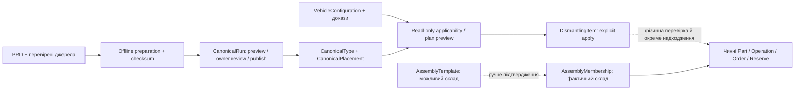

# Універсальний каталог CarPot — підготовка до контрольованого наповнення

Дата: 2026-11-10. Гілка `feature/carpot-universal-dismantling-catalogue`, основа `0c9ea7d` із перенесеним точним readiness patch з `76e3d7519af5d2eace89f882cfb2e11ecd3126a7`.

**Код підготовлено до review; реальне розширення каталогу та перший імпорт заблоковані відсутніми джерельними пакетами.** Нових реальних PRD-типів не публікували. 500+ реальних Volvo-позицій не підтверджено. Staging/production не змінювалися.

[Resume preflight](resume-audit.md) · [Фактичні джерела й SHA](source-audit.json) · [Volvo coverage](volvo-coverage.md) · [Повні test evidence](evidence/).

## Аудит і джерела

| Рівень | Фактична доступність | Що доводить / чого не доводить |
|---|---|---|
| PRD export 26 938 / safe filter 23 105 | Повні ZIP не передані в поточне середовище | Кількості задані вимогами, не перевірені на реальному CSV. Safe filter не є затвердженням фізичних деталей |
| Pilot 193 / 421 / 552 | ZIP відсутній | Жодні рядки не відтворено за припущеннями; 552 — не BOM |
| fitment spec v2 та MANIFEST.json | Відсутні | Контракти/контрольні суми архіву не підтверджені |
| Переданий список Volvo | 113 product_id + початкові назви | Доказ наявності джерельних назв, не OEM/fitment/кількості/комплектності |
| Чернетка в репозиторії | 113 draft mapping rows | 64 part, 37 consumable, 9 equipment, 3 review; усі draft, не автоматичні approvals |
| Чинний bundled словник | 216 функцій / 227 кандидатних місць | Програмний конструктивний довідник, не перевірений список Volvo |
| Оригінальна td1q2018 / робочий PostgreSQL | Не підключалися | Жодної заяви про live-покриття всіх марок чи про зміну донора №30 |

Кодові причини поточних обмежень:

- `catalogue/volvo_vehicle_import.py`: продуктова вибірка формується з `article_links`, тоді як PDS зберігається як додаткові відомості. Наявність товарної пропозиції не тотожна повноті конструкції.
- `unified_catalogue.persist`: компактний pinned план; відсутній `category_path` дає «Потребує уточнення», яку новий UI відображає як «Без категорії». Чернетка перекладу в docs сама не є публікацією.
- `canonical_rules.type_record`: канонічна identity залежить від функції й контексту категорії. Перерахунок ID за новою категорією небезпечний; наявні ID потрібно явно перевикористовувати.
- `canonical_candidates`: оголошення, варіанти й модельне групування не доводять установки на VIN; не можна механічно множити їх у фізичні місця.
- `dismantling_plan_v3`: уже має токени, preview/resolutions, ідемпотентний save, захищені legacy-зіставлення. Його використано повторно.
- `assemblies`, `inventory`, `orders`: залишаються єдиними фізичними інваріантами; новий довідник не змінює їхніх правил.

## Архітектура



Нових таблиць, черги, фінансової системи або міграції немає. Використано наявні `CanonicalRun` worker/advisory locks/session authorization, канонічні сутності та managed-plan replay/etag/token. `CatalogueEntity/Alias/Path`, `CanonicalMapping/Fitment` не переписуються.

PRD — тип номенклатури, не товарна пропозиція. Старий `CanonicalMapping` орієнтований на base/v2 джерела; PRD provenance збережено в існуючому `CanonicalType.provenance`, з точним `td1q2018:prd:<id>`, checksum і початковими п’ятьма полями. Не створено фіктивних offers, OEM або variant fitments. Явні variant fitment записи залишаються в `CanonicalFitment` і зберігаються в preview поряд із правилами типу.

Для старих canonical ID використовуються незмінні identity/name/category поля; переглянуті `corporate_path` та `display_name_uk` — метадані відображення в тому самому Type. Це не друга система категорій: валідація спирається на чинні 12 `SECTIONS/SUBCATEGORIES`. Імена на складі автоматично не перейменовуються.

## Підготовка та публікація

`universal_catalogue.prepare`:

- Ідентичність джерела — PRD ID + точний hash полів, не normalizeddescription.
- Без явного рішення запис потрапляє в review. Схожість слів не стає дозволом на злиття.
- Повтор того самого джерела обліковується як duplicate row; інший вміст для того самого ID — помилка.
- Для наявної функції в іншому контексті потрібен явний target canonical ID. Переприв’язка вже опублікованого PRD ID до іншого типу блокується.
- Витратні матеріали, обладнання, інструменти й хімія не входять у конструктивні кандидати. `review` не перетворюється на approved.
- Українську назву й синоніми затверджує reviewer; повторно використовуються чинні Type/словник. DeepL або інша платна служба не викликаються.
- Installation дозволяється лише з окремим доказом. За відсутності такого доказу — одна невизначена кандидатна позиція з `quantity=None`, без автоматичного left/right чи множення за кількістю оголошень.

Адміністративні API (той самий platform-admin gate та CanonicalRun history):

- POST `/api/v1/catalogue/admin/canonical/universal/preview`: `{rows, reviews, input_sha}`. До 500 рядків і 2 MiB на запит.
- POST `/api/v1/catalogue/admin/canonical/universal/publish`: `{mode:"publish", preview_id, token, confirm:true}`.
- Статус через чинний GET `/api/v1/catalogue/admin/canonical/runs/{id}`.

Preview не публікує типи. Worker повторно перевіряє checksum і стан каталогу; unresolved review блокує publish. Publish атомарний, не видаляє старих типів/позицій і не торкається складу. Повтор завершеної публікації повертає той самий run. Багато пакетів обробляються послідовно preview→review→publish; завершені CanonicalRun є checkpoint. Після зміни каталогу старий preview потребує повторення. Перерваний пакет відкочується й повторюється явно; це не приховане partial publication.

Джерела, версія, актор review, синоніми, installation evidence та правила зберігаються в наявних provenance/run records. Окрема UI-форма масового source-review не реалізована: підготовка та керування пакетами наразі через CLI/API і чинну історію адміністрування.

## Застосовність і повторна генерація

Правило містить ID, версію, умови, effect, priority, evidence та пояснення. Потрібні точні **verified** факти конфігурації. Невідомі/неперевірені, суперечливі факти або протилежні переглянуті правила дають needs_review. Priority упорядковує пояснення, не приховує суперечність. Опції не вважаються повними без підтвердженого документа.

Внутрішні сумісні стани `confirmed / unknown / incompatible` мають явне відображення `applicable / needs_review / incompatible`. Applicable означає застосовність правила до конфігурації, не фізичну наявність на VIN.

POST `/api/v1/vehicles/{id}/universal-plan/preview` і POST `/api/v1/vehicles/{id}/universal-plan` повторно використовують managed-plan. У вкладці розбору є згорнутий preview/рішення/save, без перебудови основного UI. Рішення показуються порціями по 30. Несумісні нові кандидати пропускаються; невідомі залишаються. Історичні позиції не видаляються.

Точний PRD key допомагає запропонувати зіставлення зі старим global plan, але неоднозначність потребує рішення власника. Лише при явному link можна уточнити порожню категорію **неоприбуткованої** позиції; збережено ID, власну назву, кількість, inspection/note та виключення. Для global source використовуються його старі стабільні category keys — без дублювання категорій. Part та складська історія не перекласифіковуються автоматично.

Перегенерація не створює Part, не відновлює продане, не знімає резервів, не змінює ціну й не переприв’язує фізичні компоненти. Нові reviewed candidates ввімкнено лише у новому explicit universal preview; старий virtual activation шлях збережено окремо. Старі market placements не підвищуються до універсальних конструктивних місць без review.

Шаблон вузла залишається довідковим `AssemblyTemplate`, фактичне дерево — `AssemblyMembership`. Немає автоматично засіяного заводського BOM дверей/двигуна. Дані для нових перевірених шаблонів відсутні.

## Тести та класифікація падінь

Повторені команди й повні traceback у `evidence/`. Порівняння виконано в окремому detached worktree базового `0c9ea7d`, на тому самому локальному PostgreSQL/test DB, послідовно з fixture cleanup.

| Перевірка | Результат | Висновок |
|---|---|---|
| Початкові 14 нових тестів | 14 PASS | Відновлений код працює |
| Точний початковий прогін 4 файлів | 64 PASS / 3 FAIL | Ті самі три FAIL, що на base |
| `test_real_A_xc90_read_only_example` | Base і feature: HTTP 409 «Потрібен новий preview» | Старе базове падіння fixture/publication; реальне Volvo E2E не підтверджене |
| `test_real_A_xc90_plan_and_multiple_donors` | Base і feature: той самий 409 | Старе базове падіння, не нова регресія |
| `test_additive_migration_on_populated_legacy_db` | Base і feature: downgrade завершується RuntimeError | Історичний сценарій несумісний із чинною forward-only політикою f7; SQLSTATE відсутній, SQL не є причиною |
| Додатковий Canonical compatibility | 28 PASS / 2 FAIL / 1 deselected | Обидва FAIL окремо відтворені на base |
| Concurrent worker fixture | Base/feature: 201 після timeout slow fixture замість очікуваного 409 | Старе базове concurrency/timing падіння, не оголошено PASS |
| Full real-A normalization fixture | Base/feature: той самий preview 409 | Старе базове падіння |
| Фінальний targeted safety набір | **65 PASS**, без skip | Нові source/ZIP/CSV/rules/500-slot/reconciliation та Assembly/receipt safety |
| Frontend targeted/readiness suites | **418 PASS** | Включно з перенесеним f7 readiness fix |
| TypeScript/Vite build | PASS | Попередження chunk >500 kB лишається |
| Browser 1440/390, Day/Night | PASS | Partial113, preview оновлення, no stock writes з preview, без pageerror/overflow |
| Parent→head на новій локальній DB | PASS | Збережено donor/Part/operation/buyer/order/plan, quantity=5, reserved=2, USD123.45 |

Тести не змінено на фіктивний pass/skip. Історичний downgrade був реально запущений і задокументований; замість видалення історії додано evidence правильного forward upgrade. Єдина head — `f7a10b8c43d2`; нових міграцій у цій реалізації немає.

Під час відновлення знайдено й виправлено нову помилку: reviewed universal кандидати зачіпали старий virtual path (у fixture — TypeError нового аргументу). Їх відокремлено новою ознакою лише для нового API. Друге падіння нового тесту було порівнянням формату ціни `100`/`100.00`, виправлено числове порівняння. До/після evidence збережено.

500-slot тест — **синтетичний**, не джерельний Volvo: publish→preview→apply→replay→regen з ручними рішеннями, резервом, фактичним assembly link та історично проданою третьою позицією. Кількість/ціни/валюта/ID/історія не змінюються. Offline benchmark 26 938 **синтетичних** рядків: [вимір](evidence/offline-benchmark.json), жодного автоматично approved типу. Ці результати не підтверджують реальний PRD чи factory coverage.

## Скриншоти

[Огляд Day 1440](screenshots/partial113-1440-day.png) · [Огляд Night 1440](screenshots/partial113-1440-night.png) · [Огляд 390](screenshots/partial113-overview-390-day.png) · [Картка Night 390](screenshots/partial113-390-night.png) · [Preview Day 1440](screenshots/universal-review-1440-day.png) · [Preview Night 390](screenshots/universal-review-390-night.png).

На всіх зображеннях явно локальний synthetic donor. Порівняння з еталоном не підміняє staging QA.

## Windows: підготовка відсутніх джерел

Із кореня checkout, SOURCE_* уже встановлені у вашому локальному середовищі. Паролі не включаються в команди/звіти:

```powershell
py warehouse\scripts\inspect_resume_inputs.py C:\CarPot\CARPOT_CATALOGUE_CODEX_RESUME_INPUTS_2026-11-10.zip
py -m pip install -r catalogue\requirements.txt
py warehouse\scripts\export_universal_source.py --car-id 107555 --output C:\CarPot\exports\universal-2026-11-10
py warehouse\backend\scripts\prepare_universal_catalogue.py --input C:\CarPot\exports\universal-2026-11-10\prd.json --output C:\CarPot\exports\universal-review.json --batch-dir C:\CarPot\exports\universal-preview-batches
```

ZIP перевіряється за MANIFEST, із захистом від traversal/symlinks/duplicates/unlisted members/size; витягується лише в нову системну temp directory. Вміст документів не виконується. Перевірити наявність чотирьох очікуваних джерел у виведеному manifest inventory. Невідому структуру MANIFEST скрипт відхиляє, не вгадує.

Експортер використовує існуючі `catalogue/selective_import.py::connection` та `volvo_vehicle_import.py::read/import_summary`. Дозволено тільки localhost td1q2018 і `START TRANSACTION READ ONLY`; наприкінці rollback. Експортує п’ять PRD-полів, information_schema/FK, article_links/PDS gap для зазначеного car_id. Trees не трактуються як додаткові деталі без доказів. Можна передати `--snapshot` для локального import_summary. Немає upload, DDL/DML, індексів або виводу secrets.

Залежності Windows: Python, PyMySQL із чинних catalogue requirements; локальні `catalogue/selective_import.py`, `volvo_vehicle_import.py`, `volvo_contract.py` та їхні чинні імпорти. Offline compiler додатково використовує встановлені backend requirements/Pydantic і чинні app/data словники. Він не відкриває DB. JSON/CSV з явними PRD headers підтримуються; source ID не замінюється загальною назвою. Raw review/batch files відмовляється писати всередину Git checkout. Відправлення batch requests та publish лишаються явними адмін-діями; скрипти їх не виконують.

## Межі готовності та rollout

1. Надати відсутній ZIP і перевірити його MANIFEST/SHA; окремо прочитати fitment spec v2. Наразі цей gate **BLOCKED**.
2. Перевірити кандидатні PRD classifications, переклад/синоніми, джерельні права й конструктивні докази. Pilot слоти не публікувати як OEM BOM.
3. На локальній копії зі збереженням старих IDs пройти послідовні reviewed batches, зібрати реальну coverage-матрицю Volvo та інших конкретних модифікацій. Розширені параметри сидінь/підвіски/об’єму, не підтримані чинним ConfigurationFact, потребують узгодженого spec, не вигаданих правил.
4. Розглянути цей feature PR та відомі базові FAIL. Окремо погодити staging-приймання; оновити API й чинний canonical worker до одного SHA до enqueue нових job kinds. Старий worker не є підтвердженням підтримки нового контракту.
5. Перевірити actual deployed SHA, packaged head, права, поточний план; лише потім явні source preview/publish і donor preview/apply. Фізичне надходження залишається окремою дією.

Ні merge, ні Railway deployment, ні робочі migrations/imports, ні платні API в межах цього завдання не виконувалися. Немає підстав оголошувати завершеним наповнення або підтверджувати 500+ реальних деталей. Кодова основа придатна до review; перший реальний імпорт і повне source acceptance залишаються заблокованими даними.


Оновлення 2026-11-10: [поточний review усіх 113 Volvo-типів](volvo-review/README.md). 81 proposed / 32 needs_review; це замінює попередні припущення про готовність категоризації, але не змінює джерельні ID чи підтвердження fitment.
