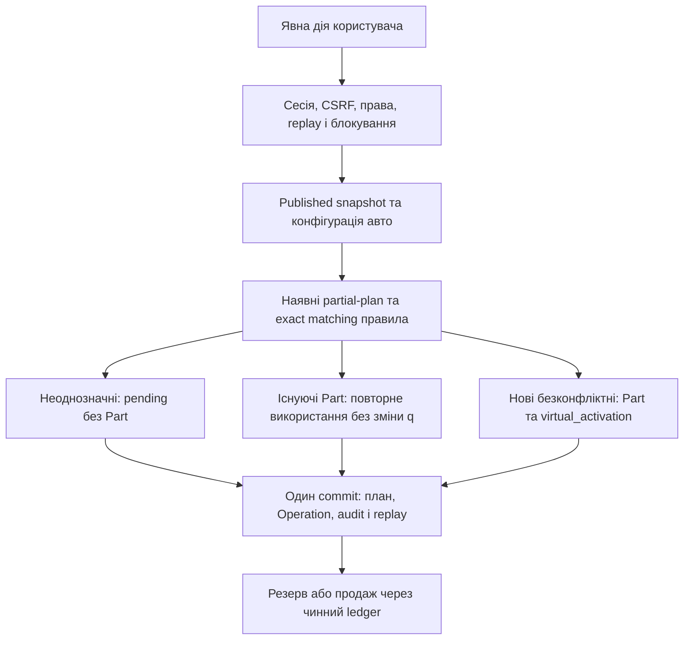

# Stage 3A — Virtual Warehouse: аудит і архітектура

Статус: **AUDIT / DESIGN COMPLETE; реалізація Stage 3B ще не виконана**.

Перевірена база: `db0e532c7cace236e3e8b4714263b7110fbf93fb`, `feature/carpot-warehouse-mvp`. Локальна Alembic-head: `84d2c6fa190b`. Дата: 2026-10-29 (Europe/Kyiv). Цей документ — пропозиція майбутньої архітектури, а не опис уже впровадженого Virtual Inventory.

Аудит виконаний читанням моделей, схем, сервісів, API, дозволів, frontend і наявних регресій. Дані staging, реальний Volvo B, фактичні залишки та Railway у цьому етапі не читались. Бізнес-логіка, схема й дані не змінені. Push, deployment, parsing, normalization/publish, reset та backfill не виконувалися.

## 1. Висновок і межі зміни

Stage 1–2E свідомо відділяє потенційний план від складу: Quick Create створює `DismantlingItem(status='unchecked')`, не `Part`. Лише явний receipt створює/пов'язує Part і збільшує залишок після підтверджень наявності та демонтажу. Це коректно для попередньої моделі, але суперечить новій моделі продажу деталей, що ще фізично на донорі.

Рішення: **один Part на облікову конструктивну позицію/лот, одна наявна Operation-історія**. Віртуальна активація створює редаговане облікове припущення кількості, не підтвердження OEM/фактичного демонтажу. DismantlingItem залишається джерелом ідентичності та планування. Order/OrderLine/OrderReservation залишаються комерційним процесом. Другий незалежний ledger або окремі «віртуальні продажі» не потрібні.

Неможливо просто додати автоматичний виклик старого `receipt()`: це підробить фізичне надходження, історію та eligibility, а повторна генерація може повернути продану деталь у залишок.

## 2. Фактична карта коду

Шляхи в таблицях — від кореня `warehouse/`; API наведено з `/api/v1`.

| Об'єкт | Фактична структура й обмеження | Код |
|---|---|---|
| Workspace/actor | `Account.id`, `workspace_account_id`, роль, permissions; власник workspace DIRECTOR, працівники мають інший actor ID | [models](../../backend/app/models/__init__.py), [deps](../../backend/app/api/deps.py), [permissions](../../backend/app/permissions.py) |
| Vehicle | Власник, марка/модель/рік/двигун/VIN, acquisition_cost; `dismantling_v3` JSON із revision/configuration/pending | [models](../../backend/app/models/__init__.py), [configuration](../../backend/app/services/vehicle_configuration.py) |
| DismantlingItem | Workspace/vehicle, stable source key, included, inspection у plan_v3, status, quantity; unique vehicle+placement JSON index і unique part_id | [models](../../backend/app/models/__init__.py), [v3 service](../../backend/app/services/dismantling_plan_v3.py) |
| Критична receipt-залежність | CHECK вимагає `(part_id IS NULL AND received_at IS NULL)` або обидва NOT NULL. Немає способу зв'язати Part без receipt. FK Part лише за ID, без account-composite | Ті ж models, `ck_dismantling_receipt_link` |
| Part | quantity ≥ 0, 0 ≤ reserved_quantity ≤ quantity, available_quantity=q−r; condition, currency UAH/USD, selling_price/unit_cost nullable, location string, archived; availability — старий inspection enum | [models](../../backend/app/models/__init__.py) |
| Operation | actor/account/entity/part/vehicle, type string, before/after JSON, reason/time; не окрема таблиця балансів; stock() змінює Part і додає Operation в тій же транзакції | [inventory](../../backend/app/services/inventory.py) |
| Receipt | Окремої моделі Receipt немає: це `Operation(type='receipt')` плюс `DismantlingItem.received_at` і зв'язок Part | [dismantling](../../backend/app/services/dismantling.py) |
| Buyer | Workspace-контакт, нормалізовані телефони; не складський об'єкт | [orders models](../../backend/app/models/orders.py) |
| Order | Workspace number, Buyer, delivery, status, sold_at. Статуси замовлення не є статусами Part | Ті ж models |
| OrderLine | Знімок назви/донора/ціни/валюти/кількості, line_total, sale_operation_id; активний рядок одного Part у замовленні унікальний | Ті ж models |
| OrderReservation | Part+line+account composite FK; active/released/consumed, quantity, посилання на reserve/release/sale Operation | Ті ж models, [orders service](../../backend/app/services/orders.py) |
| Replay | StockRequest, OrderRequest, DismantlingRequest — різні області команд, не ledgers; fingerprint/actor перевіряються | Models, [dismantling_request](../../backend/app/models/dismantling_request.py), відповідні services |
| Catalogue v1 | AletoModel/Offer/Price/Application/Taxonomy workspace-scoped, сумісність збережена | [aleto models](../../backend/app/models/aleto.py) |
| Catalogue v2 | Глобальні CatalogueEntity (manufacturer/model/category/subcategory/part_type), Alias, Source, Offer, Price, Application, Path, State, Job/Operation | [catalogue models](../../backend/app/models/catalogue.py) |
| Canonical v3 | Type/Placement/Variant, append-only aliases/fitment, Mapping за snapshot, Run, CanonicalState; кількостей складу немає | [canonical models](../../backend/app/models/canonical.py) |
| Джерельна конфігурація | VehicleConfiguration і resolver з provenance/confidence; fitment не доводить фізичну присутність | [configuration model](../../backend/app/models/vehicle_configuration.py), [preview](../../backend/app/services/dismantling_preview.py) |

### Фактичні API та поведінка

| API | Що є зараз |
|---|---|
| GET/POST `/vehicles`, GET/PUT `/vehicles/{id}`, PATCH `.../powertrain` | Облік донора; GET `/vehicle-catalog` змішує незалежні підказки назв, v1/v2 та workspace-назви; coverage не віддає |
| GET `/vehicles/{id}/dismantling-v3` | Поточний план, counts/eligibility/stock, read-only |
| POST `.../dismantling-v3/preview`, `/save`, `/quick` | Preview, строгий save, частковий Quick Create. Quick використовує актуальний snapshot, дедуплікацію/legacy і pending; створює тільки unchecked план |
| POST `.../decisions` | Старі явні рішення плану з replay/etag |
| GET `.../selection`, POST `.../bulk/preview`, `.../bulk` | Stage 2E: до 1000 ID на команду, eligible subset atomic. UI порції 1000, receipt 100; multi-batch не одна транзакція |
| `/vehicles/{id}/dismantling/...` | Legacy start/workspace/plan/batch/add-stock і receipt workflow у [API](../../backend/app/api/dismantling.py); сумісність потрібно зберегти, але не дозволити повторно активувати virtual Part |
| GET `/parts`, `/inventory`, GET/POST/PUT `/parts...` | Звичайний склад; in_stock зараз q>0, немає assortment_enabled. `availability` не комерційний статус |
| POST `/parts/{id}/operations`, PATCH `/parts/{id}/price`, POST `/parts/bulk-actions` | Receipt/correction/write_off/reserve/release/sale/transfer. Price окремо з валютою; масові й одиночні обходи треба врахувати разом |
| `/buyers`, `/orders`, `/orders/{id}/lines`, POST `/orders/{id}/{reserve,release,sell,cancel}` | Buyer/order workflow; stock() — єдина зміна кількостей; фактична ціна — immutable sale snapshot, не поточна selling_price |
| GET `/dashboard`, `/vehicles/{id}/analytics`, `/audit` | Поточні кількості/оцінка й історія; агрегації наразі не знають included/virtual basis |
| `/catalogue/admin/jobs...`, `/catalogue/admin/canonical/runs...` | Стійкі PostgreSQL-команди import/preview/apply і canonical preview/publish з окремою owner-авторизацією |
| GET `/catalogue/canonical/candidates`, `/vehicles/{id}/dismantling/candidates`, admin diagnostics | Read-only кандидати/діагностика; unpublished не є повним каталогом. Preview має явний base fallback |

Чинний порядок блокувань неоднорідний: orders — account NO KEY UPDATE → order → sorted Parts; stock з request_key — account UPDATE → Part; v3 — Vehicle → catalogue advisory lock; receipt додає Account lock після Vehicle. Для нового cross-workflow це ризик deadlock, а не готовий універсальний протокол.

## 3. Virtual Inventory — цільова модель

### Залишки й provenance

`Part.quantity` продовжує означати облікову кількість непроданих/несписаних одиниць, незалежно від того, на автомобілі вони чи на полиці. `reserved_quantity` — зайнята частина q. Не додавати `virtual_quantity`, другу таблицю залишків або незалежний reserved flag.

Запропоновані поля:

| Об'єкт | Зміна для Stage 3B | Інваріант |
|---|---|---|
| Part | `assortment_enabled` boolean default true | Видимість асортименту незалежна від q/архіву; вимкнення не обнуляє q |
| Part | `inventory_origin` enum/text: legacy/manual/virtual_donor | Джерело початкового обліку, не доказ стану всіх майбутніх одиниць |
| Part | `quantity_basis` enum: legacy/assumed/verified | Початкове 1 — assumed; корекція не означає verification без явної перевірки |
| Part | `physical_location_kind` unknown/on_vehicle/on_shelf; existing location — адреса/полиця | Не впливає на q, reserve, sale; для legacy unknown, не вгадувати |
| Part | `canonical_placement_id` nullable FK; `activation_operation_id` nullable unique FK | Походження та точна ідентичність; ніколи не виводити OEM з одного placement |
| Part | condition дозволяє `unknown` | Згенеровані дані не отримують удаваний перевірений used; legacy used не переписується |
| DismantlingItem | Залишити part_id unique; дозволити зв'язок без received_at; додати composite FK part_id+account_id | Наявний received_at означає саме виконаний старий фізичний receipt; не використовувати його як virtual activation marker |
| DismantlingItem | included — сумісна проєкція `Part.assortment_enabled` після зв'язування | Для пов'язаних рядків пише лише спільний сервіс, не два незалежні перемикачі |
| Vehicle | Явна версія workflow/mode (legacy_plan / virtual_v1) у versioned metadata або окреме поле | Нові команди не змінюють семантику старого запиту непомітно |

Унікальність canonical Part: partial unique `(account_id, vehicle_id, canonical_placement_id)` де placement NOT NULL для несplit-позицій. Перед міграцією — read-only перевірка колізій. Не fuzzy-об'єднувати legacy; неоднозначне лишається pending. Якщо згодом потрібні різні фізичні лоти однієї позиції, унікальність переноситься на root inventory identity, а split має explicit parent/root; Stage 3B не створює автоматичних split-лотів.

Одна Part — однорідний лот в одній локації. Для q>1 перенесення частини на полицю потребує окремого спроєктованого split-lot transfer у тому ж Operation ledger (q переноситься, не додається). До його реалізації UI дозволяє переміщення всього лота або повідомляє обмеження; не приписує всім одиницям місце лише однієї. Нову таблицю фізичних лотів не вводити без потреби.

### Складські події

Запропонований новий внутрішній тип `virtual_activation`: створити Part з q=0, у тій же транзакції застосувати delta +1 через розширений inventory stock service та записати Operation. Не викликати старий receipt(). Передавати provenance: command/request key, actor/workspace/vehicle, DismantlingItem, canonical placement/snapshot/rule/configuration revision, quantity_basis=assumed, origin, rule version. Це не виручка, не витрата, не receipt і не підтвердження реальної комплектації.

`Operation.type` зараз string без enum CHECK, але тип не приймається чинним StockInput. Новий тип доступний лише через внутрішню авторизовану команду, не довільний POST operations. Обов'язкова allowlist dispatch в stock(): невідомий тип відхиляти, а не записувати порожню операцію.

`virtual_activation` виконується рівно один раз на inventory identity, захищено unique activation_operation_id/placement і replay. Повторна генерація може додати тільки нові безконфліктні позиції. Вона **не встановлює q=1** для існуючого Part, навіть q=0 після продажу/списання; не змінює ціну, резерв, checkbox, location чи inspection. Повторне включення також не є активацією.

Фізичне зняття вже активованої деталі — `transfer`/location update з аудитом, delta=0. Старий receipt для virtual identity повертає 409 з переходом до переміщення. Реальне нове додаткове надходження допускається лише окремою складською командою з причиною/кількістю; ніколи як другий клік «демонтовано».

Audit before/after зберігає q/r/visibility/location і actor; Operation — логічно append-only через API. Поточний ORM сам по собі не доводить DB-level immutability: за потреби обмежити UPDATE/DELETE роллю БД окремою погодженою міграцією. Не переписувати старі snapshots.

## 4. Атомарна однокнопкова команда

Пропозиція: новий versioned `POST /api/v1/vehicles/{id}/virtual-dismantling/activate` з request_key, expected_plan_revision/etag, явною user action. Не перевизначати старий `/quick`: його клієнт очікує «received=0 і жодного Part».

1. Session+CSRF+workspace від серверної сесії; `vehicles.view`, `catalog.view`, `dismantling.manage`, `inventory.create` і окремий `inventory.activate_virtual`. Не platform-owner: workspace inventory operation не є публікацією глобального каталогу.
2. Єдиний порядок для всіх залучених writers: Account NO KEY UPDATE → Vehicle (якщо потрібен) → Order (якщо потрібен) → sorted DismantlingItems → sorted Parts. Перевірити й адаптувати legacy receipt/stock/bulk/orders, не лише новий endpoint. Невдалий lock timeout — контрольований retry без часткового commit.
3. Перевірити replay перед перевіркою нового etag. Той самий actor/key/body повертає збережений результат; інший body/actor — 409. Для нової команди використовувати DismantlingRequest з окремим kind у fingerprint; не створювати четвертий ledger.
4. Взяти неочікувальний спільний catalogue mutation advisory lock або стабільний immutable snapshot reader; на першому релізі повторно використати наявний try-lock. Якщо зайнято — 409, не довго тримати Account lock. Catalogue writer не повинен чекати workspace-lock у зворотному порядку.
5. Перевірити published snapshot і конфігурацію, побудувати актуальний partial_plan. Для unpublished — зрозумілий 409 і окремий явний manual/base шлях; не називати fallback повним канонічним розбором.
6. Використати існуючі exact identity/legacy rules та connected ambiguity groups. Pending не створює Part і не є виключенням. Прийняті skip/link/new зберегти; OEM/сторони/кількість не домислювати.
7. Нові безконфліктні DismantlingItem + Part + activation Operation створити атомарно; початкове q=1 assumed, location=on_vehicle, enabled=true, price/cost=NULL, condition=unknown. Існуючі зв'язки та старі фізичні receipts повторно використати без delta.
8. Для старого DismantlingItem без Part не активувати автоматично весь історичний план: потрібен показаний count та окрема явна команда «Активувати старі потенційні позиції». Вона не скидає виключення та не працює з неоднозначними sold/legacy links.
9. Commit плану, складських подій, audit і replay-result разом. Відповідь: created_parts, activated_units_assumed, reused, pending, skipped, unchanged_stock, revision; «Віртуальний облік; фізичний демонтаж не підтверджено». Продажна ціна не встановлена.
10. HTTP disconnect не є відкатом уже committed команди: reload читає сервер, retry використовує той самий ключ. До commit process death → rollback. Якщо профілювання показує неприпустимий час, durable server command job з єдиною business transaction і окремим progress connection; не BackgroundTasks-only, не приховані часткові commits. Обмеження обсягу й performance budget підтвердити тестом до релізу.

## 5. Три стани, кількості та checkbox

Позначення: q=Part.quantity, r=reserved_quantity, a=q−r, s=історичні продані одиниці з Operation sale (повернення потребують окремої event policy, зараз не вигадувати return API).

| Умова | Основний напис | Додаткові кількості |
|---|---|---|
| q>0, a>0 | В наявності | Вільно a; якщо r>0 — «Зарезервовано r»; якщо s>0 — «Продано s» |
| q>0, a=0, r=q | Зарезервована | r одиниць, вільно 0 |
| q=0 і є sale history | Продана | Історичні продажі, доступно 0; не можна вмиканням додати q |

Для q=5/r=2/s=3 не обирати один прапорець замість кількостей: основний напис «В наявності», вільно 3, резерв 2, продано раніше 3. Order.status залишається незалежним. При змішаній історії sale + write_off показувати точні продані/списані кількості; нульовий q не означає, що всі колишні одиниці продано.

Важливий крайовий випадок: q=0 без продажу (повне списання/корекція/ще не активований manual Part) **не є «Продана»**. Такий рядок не входить до активного товарного списку; у згорнутій історії показати причину нульового залишку, а не четвертий комерційний статус. Відсутність Part теж не можна представляти як доступний товар. Це необхідна межа вимоги «лише три стани».

Checkbox у Stage 3B означає **включено в асортимент**, а не Stage 2E selection. Візуально відділити тимчасовий режим вибору для bulk від persisted checkbox доступності; не використовувати один checkbox для двох значень.

- Вимкнути: q і історія не змінюються; під Part lock r>0 → 409 із посиланням на замовлення/ручний резерв. Не знімати резерв приховано, навіть якщо вільна частина >0.
- Увімкнути: дозволено з наявним q>0 та неархівним Part; не створює stock event/delta. q=0 → зберегти історію, показати неможливість зробити доступним без окремого фактичного надходження/корекції.
- Вимкнений Part не можна ново резервувати/продавати через жодний API (orders, quick sale, bulk, старі endpoints). Існуючий order draft перевіряє enabled повторно при reserve/sell. Release/cancel доступні для розблокування.
- Для legacy Part без DismantlingItem той самий Part.assortment_enabled; у пов'язаного рядка included оновлюється атомарно. Archive залишається окремим життєвим циклом, не заміна checkbox.
- Category/subcategory/all: Stage 2E server selection і etag; UI повідомляє eligible/blocked. До 1000 на команду, кожна порція atomic, completed prefix не відкочується; не обіцяти atomic всього набору.
- Зміна кількості — тільки audited correction з причиною: q>=r; зниження не підміняє sale, збільшення не вважається factory evidence. unit_cost і selling_price задаються явно з наявними permissions.

Фінанси: виручку й фактичну ціну брати з immutable sale Operation/OrderLine. Virtual activation не фінансовий дохід і не allocation acquisition_cost. Оцінку асортименту відділити від фізично перевіреного складу; NULL ціни/собівартості не називати нульовою ринковою вартістю. Dashboard/search/stock counters повинні врахувати enabled і origin, не приховувати резервовані/продані історії.

## 6. Price Guidance Service

### Що є

CatalogueOffer: source/article, properties, observed_at. CataloguePrice: offer+observed_at unique, nullable UAH/USD prices і source_url. Окремого normalized condition/currency observation row немає; condition береться з properties. CanonicalVariant містить oem/attributes, а Mapping і candidates `_sources` пов'язують варіант із пропозиціями.

`canonical_candidates.py` обчислює загальні min/max по спостереженнях — це не надійний comparable market cohort. `dismantling_preview.price_summaries()` вже краще: latest observation per v2 offer у межах 90 днів, exact variant із OEM, condition/cosmetic/currency cohorts, мінімум 3 пропозиції, median. Проте source_url кожного прикладу не повертає, 1–2 приховує, без OEM не працює, v1 не входить у цей summary; стан/інші атрибути в properties можуть бути неповні. Canonical variant сам по собі не доказ повної взаємозамінності.

### Цільовий контракт (read-only)

`GET /parts/{id}/price-guidance` → version/as_of/snapshot/cohorts[]/unmatched_reasons; workspace ownership Part перевіряється, джерельний каталог глобальний. Batch read endpoint для карток, щоб не N+1. UI показує поруч «Ваша ціна» й «Ринкові приклади», без автоматичної мутації Part.

Кожний cohort: match_degree exact_oem / verified_functional_example, type/placement/known constraints, OEM і відмінності, condition/unknown condition, currency, unique_offer_count, latest observation age window, min/max/median лише для достатнього n; examples[source,article,url,observed_at,amount,currency,OEM,condition,known_differences,evidence_id]. Зберігати і source_observed_at, і fetched_at, не видавати дату імпорту за дату вихідного оголошення. Якщо джерело дати не дає — явно unknown/ingestion time.

Правила:

1. Дедуплікація за source+article (з перевіреним cross-source duplicate identity за наявності); одна актуальна observation на offer, без множення на paths/models. Не змішувати кілька дат одного оголошення чи дзеркала як незалежний ринок.
2. Exact OEM нормалізувати без fuzzy та без втрати значущих суфіксів; застосовність, side/position, паливо/двигун, стан, cosmetic і валюта мають бути порівнювані. Невідоме значення не дорівнює відомому. Різні когорти не усереднювати.
3. n>=3: min/max/median у межах однієї когорти. n=1–2: показати конкретні ціни з написом «Мала вибірка», без удаваної надійної медіанної рекомендації.
4. Без точного OEM: лише явне verified functional relevance evidence + відомі відмінності; окремий блок «Приклади схожої функції», не fitment/OEM-equivalent і не автоматичний bulk price default. Не fuzzy за назвою.
5. Немає релевантних/актуальних даних — «Ціну не визначено». Нульова ціна, невідомий стан, конфлікт валюти не повинні утворювати фальшивий орієнтир.
6. Не змішувати UAH/USD, не конвертувати мовчки. Якщо пізніше потрібен FX, окремий курс+дата+source; оригінал зберігається.

Storage: зберегти CatalogueOffer/Price як source of truth. Додати normalized `CatalogueOfferEvidence` або additive versioned evidence fields із condition/provenance/known attributes/source timestamps; якщо attributes можуть змінюватись, потрібна історія за observation, а не лише поточні properties. Guidance projection/cache не є джерелом цін; ключ включає snapshot, catalogue revision, policy version, as_of bucket і normalized criteria. Для bulk price preview — durable PriceGuidanceRun/Decision (або загальна command таблиця з чіткою domain schema), fingerprints конкретних observations/Part revisions та explicit owner consent.

Масове встановлення власної ціни: workspace-owner preview → вибір правила exact cohort/валюти/округлення → показ before/after і всіх exclusions → явне confirm → revalidate current revisions/rights → audited part_price events. Existing sale/OrderLine snapshots не змінюються. Missing/functional-only/low-sample не вибираються автоматично; explicit per-item override доступний. Це не глобальний platform-owner publish, але початкова політика bulk pricing — лише власник workspace плюс parts.change_price.

## 7. Глобальний довідник автомобілів

Не створювати вдруге manufacturer/model: використати чинні `CatalogueEntity(kind=manufacturer/model)` як глобальні ідентичності; API повертає типізовані Manufacturer/Model representations. Додаткові таблиці:

- `CatalogueModelPeriod`: model_id, verified label, nullable from/to, source/evidence/status. Не вигадувати роки покоління або виводити їх із року одного донора.
- `CatalogueSourceIdentity`: source_id, entity_id, external_key/source_url, observation time; unique(source_id,kind,external_key), явні модераторські merge aliases. Зберегти відмінності назв у джерелі.
- `CatalogueCoverage`: model/period/source, catalogue_revision, canonical_snapshot, last_parsed_at, last_normalized_at, last_published_at, offers/applications/paths, verified/unresolved/types/placements, price-cohort coverage, declared scope і evidence. Coverage — recomputable projection з посиланнями на jobs, не вигаданий прапорець complete.
- `CatalogueDemand`: workspace, requested manufacturer/model/year/period, normalized identity nullable, status/timestamps; уникати VIN/особистих даних у глобальній demand-аналітиці. Дедуп запитів workspace+identity, moderation mapping для невідомих назв.

«Готовий каталог» означає наявний published snapshot для визначеного scope, а не повну заводську комплектацію. Показувати джерело, дату й обсяг; «модель відома» не дорівнює «каталог готовий». Known model без coverage має той самий чесний fallback, що й manual.

«Інше авто / додати вручну»: незалежні назви+ручне введення; явний універсальний конструктивний base snapshot, позначений як базовий, і опційна реєстрація попиту. Це окремо від випадкового unpublished fallback. Він також проходить partial/conflict rules; quantity=assumed і OEM unknown. Безпечне додавання до global names — модераторська дія, не довіра до будь-якого workspace input.

## 8. Parser Worker — майбутній, не реалізований

Перед першим HTTP crawl необхідно перевірити чинні умови Aleto, robots/дозволені URL, ліцензію/зберігання/перепублікацію/ліміти та технічний API. Stage 3A цього не перевіряв і дозволу на scraping не встановлює. Не обходити login/CAPTCHA/access controls; якщо умови не дозволяють автоматизацію — офіційний export/import.

Окремий процес/сервіс із bounded memory, concurrency і timeout; не Warehouse API request handler. PostgreSQL `ParserJob`/checkpoint/attempt/evidence artifacts, queued/running/review/done/error/cancelled, lease owner/expiry/heartbeat, partial unique active(source,model,period,mode), `FOR UPDATE SKIP LOCKED`. Source-wide rate budget, Retry-After/exponential backoff+jitter, retry cap, circuit breaker. Збережені page cursors і content SHA забезпечують restart; загублений lease не дозволяє двом attempts фіналізувати один artifact (fencing token).

Pipeline:

1. Авторизований модератор синхронізує source identities/manufacturers/models у staging job, переглядає diff і підтверджує; не видаляє глобальну модель при відсутності на одній сторінці.
2. Явно обирає модель/scope, запускає parsing і бачить progress, attempts, errors.
3. Worker зберігає bounded immutable raw artifacts+manifest (source/date/hash/adapter version/license evidence), checkpoint і normalized rows. ZIP/CSV limits і source-field retention використовують v2 format/converter правила; URLs не приймаються як довільний SSRF target.
4. Завершений artifact передається тому самому Catalogue v2 importer для preview. Жодних незалежних Part/Offer-копій у worker DB.
5. Модератор переглядає зміни; глобальний apply вимагає чинний platform-owner allowlist і explicit token/confirm. Потім окремий canonical normalization preview і окремий publish. Parser role не означає права publish; відкликана сесія/роль перевіряється при виконанні.
6. Worker не тримає catalogue lock під час мережевого fetch; PostgreSQL mutation lock береться лише importer/publisher. Наявні CatalogueOperation/CanonicalRun координації повторно використовуються. Їхній поточний coarse worker lock серіалізує обробку; новий parser lease не слід змішувати з ним.

Сервісні credentials обмежені артефактами/job lifecycle; не дають прямих прав на production stock і не підміняють actor. Retention raw artifacts — окрема політика, observations/decisions/published provenance не очищаються каскадом.

## 9. План міграцій (НЕ виконані)

Числові revision ID призначити під час реалізації після актуального `alembic heads`; нижче назви, не існуючі ревізії.

| Порядок | Міграція | Безпечний зміст і умова |
|---|---|---|
| M1, Stage 3B | virtual_inventory_expand | Add Part visibility/origin/basis/location-kind/activation FK/placement; unknown condition CHECK; mode metadata; relax receipt-link CHECK до `received_at IS NULL OR part_id IS NOT NULL`; unique part_id лишається; composite FK account+part. Старі rows не отримують activation event/збільшення q |
| M2, Stage 3B | virtual_inventory_constraints | Після read-only collision/orphan audit — partial unique canonical identity, NOT VALID FK + VALIDATE для наявних рядків; mapped ORM теж оновити. Якщо конфлікти — STOP, не автодедуп/видалення. Оцінити lock/table rewrite, index concurrently в окремому Alembic autocommit block при потребі |
| M3, Stage 4A | price_guidance_evidence | Observation-scoped condition/attributes/source time evidence та command decision snapshots; existing price records зберегти, unknown не inferred |
| M4, Stage 4B | model_coverage | Period/source identity/coverage/demand tables і FK на існуючі global entities, без auto «complete»/вигаданих періодів |
| M5, Stage 5A | parser_jobs | Parser job/attempt/checkpoint/artifact metadata, active-task unique/lease fencing; без зовнішніх fetch або automatic apply у migration/startup |

Expand-first: compatible nullable/default metadata не є business backfill. Валідацію виконувати на копії заповненої БД з legacy receipts, sales, reservations, archive й canonical data. Всі head у єдиному ланцюжку від актуальної head; зараз `84d2c6fa190b`. Значення constraint/currency/condition enums узгодити зі schemas/frontend/OpenAPI/permissions і old clients.

Автоматичне перетворення всіх legacy plans у stock заборонене. Потрібна окрема explicit migration-preview/command на workspace/donor: classify existing receipt/Part/zero-sold/unlinked/pending, count і exact IDs; навіть вона не скидає old decisions. Очищення staging — окреме погодження з manifest IDs; global Catalogue v2/Volvo B/canonical snapshots/rules/aliases/price evidence за межами cleanup. Downgrade після activation не виконувати автоматично: стара CHECK/логіка не сумісна з Part без receipt.

## 10. Конкретний план Stage 3B–5A

| Етап | Результат | Залежності / gate |
|---|---|---|
| **3B — Virtual Inventory core** | M1/M2, activation command, existing ledger event, strict receipt anti-double guard, shared locking/replay, enabled policy в усіх reserve/sale paths, read projections з 3 станами | Схвалення цієї бізнес-семантики; fixture-upgrade і concurrent tests; старий quick лишається сумісним, новий workflow тільки явний |
| **3C — Основний UX і legacy adoption** | Одна primary button, persisted availability checkbox окремо від selection, categories/bulk, quantity/location/condition editing, ordinary Inventory/Orders/Sales без вимоги демонтажу; migration preview для старих donors | 3B; mobile acceptance, no silent legacy activation; перед запуском на старому донорі explicit owner consent |
| **4A — Price Guidance** | M3, exact/small sample/functional example/no-data cohorts, evidence UI, explicit bulk price preview/apply | Canonical provenance +3B Part identity; no auto prices; price/sale-history regression |
| **4B — Vehicle Registry & Coverage** | M4, model/period/source IDs, ready/manual modes, demand і computed coverage | Глобальні entity aliases, current snapshot/version IDs; не залежить від live parser; може розроблятись після узгодження core незалежно від 4A |
| **5A — Parser Worker MVP** | M5, source model sync, bounded queue/progress/checkpoint, reviewed artifacts → existing v2/v3 pipeline | 4B identities + правила доступу до джерела; rights/legal/technical gate; explicit apply/publish тільки platform-owner; жодних stock writes |

### Файли майбутньої реалізації

Не всі змінюються на одному етапі; це scope map, не список змін Stage 3A.

- 3B: `backend/app/models/__init__.py`, `models/dismantling_request.py`, нові additive `backend/alembic/versions/*virtual_inventory*.py`; `schemas/__init__.py`, `schemas/dismantling_v3.py`, `schemas/orders.py` за потреби; новий `services/virtual_inventory.py`; `services/inventory.py`, `dismantling.py`, `dismantling_plan_v3.py`, `dismantling_bulk.py`, `orders.py`; `api/dismantling_v3.py`, `api/routes.py`, `api/orders.py`, `api/dismantling.py`; `permissions.py`, `route_registry.py`. Catalogue/rules не переписувати.
- 3B/3C projections: `services/analytics.py`, `sales_analytics.py` (перевірити whitelist sale), `api/smart_search.py`, `services/checklists.py` і `plan_parts.py` (не допустити parallel activation); search indexes за вимірами account/enabled/location після EXPLAIN, а не навмання.
- 3C frontend: `ManagedDismantling.tsx`, `DismantlingBulk.tsx`, `bulkDismantling.ts`, `quickDismantling.ts`, `managed-dismantling.css`, `VehicleCard.tsx`, `VehicleForm.tsx`, `InventoryWorkspace.tsx`, `pages/Inventory.tsx`, `SalesWorkspace.tsx`, `Orders.tsx`, shared API/types/permission components. Legacy `Dismantling.tsx`/`VehicleChecklist.tsx` не повинні обходити guard.
- 4A: нові `services/price_guidance.py`, `schemas/price_guidance.py`, `api/price_guidance.py`; `models/catalogue.py` і observation migration; адаптувати `services/dismantling_preview.py`/`canonical_candidates.py` до єдиної політики summaries; price fields UI/permissions і immutable sale regressions.
- 4B: нові `models/vehicle_registry.py`, `schemas/vehicle_registry.py`, `services/vehicle_registry.py`, API; `services/vehicle_catalog.py`, `models/catalogue.py`, `VehicleForm.tsx`, `GlobalCatalogue.tsx`, `CanonicalCatalogueAdmin.tsx` для coverage.
- 5A: нові `models/parser.py`, `services/parser_jobs.py`, `parser_worker.py`, `services/parser_adapters/*`, `api/parser.py`, `schemas/parser.py`; існуючі `catalogue_convert.py`, `catalogue_format.py`, `catalogue_jobs.py`, `canonical_jobs.py` лише як узгоджені інтеграційні межі; майбутній окремий worker deployment manifest у `deploy/railway/`, не існуючий Telegram worker.
- Tests: розширити `test_stage2d.py`, `test_stage2e.py`, `test_orders.py`, finance/sales/canonical/permissions/migration regressions; нові virtual_inventory/price_guidance/registry/parser suites; browser scenarios і screenshots у docs відповідного етапу.

## 11. Ризики і рішення до Stage 3B

| Ризик | Рішення / release gate |
|---|---|
| Подвійний receipt після virtual activation | Розділити activation і received_at; guard усіх legacy/bulk routes; unique identity та durable event/replay; test q=0 після sale |
| Checkbox приховує зарезервоване | Part lock + r>0 409; reserve/sell recheck enabled; UI показує blocked і order link |
| «Продана» для списаної без продажу | Три стани тільки для товарного lifecycle; zero-no-sale у history з причиною |
| Втрата історії при перепублікації/оновленні | Immutable donor identity, link reuse; не видаляти archived/sold identities; snapshot змінився — лише new candidates і pending |
| Одна physical legacy деталь на два placements | Existing partial-plan overlap graph; composite/unique constraints; no fuzzy auto-link |
| Конкуренція vehicle/account/Part lock | Узгодити всі writers і FK lock modes; load test refresh vs sale/reserve/receipt; timeout/retry, не прихована часткова mutation |
| Хибна комплектація/кількість/стан | q=1 assumed, condition unknown, provenance; не називати fitment фізично перевіреним; opt-in quantity changes |
| Mixed location q>1 | Homogeneous lot policy; partial move відхиляти до explicit split design |
| Ціна й фінанси завищені | Guidance separate, no autoset; actual sale snapshot; distinct virtual vs verified inventory valuation |
| Price bias/дублікати/застарілі або невідомі дані | Один offer/latest observation per cohort, evidence+age window, clear sample size/mismatch reasons |
| SQL N+1 і довгі транзакції | Batch candidate/identity reads, bounded ID writes, no per-row network; measure queries/flush/memory at realistic sizes до async decision |
| Migration блокування/несумісні old clients | Expand/validate, clone populated DB, versioned command; old workflow receipt guard обов'язковий ще до нового UI |
| Source access/worker privileges | Legal/technical gate; allowlisted sources, SSRF guard, scoped worker, owner-only publish |

## 12. Тестування та staging release

Stage 3A змінює лише документацію; перевірка — factual references, schema/API/source inspection, single Alembic head і `git diff --check`. Повний runtime regression повторювати для незміненої бізнес-логіки не потрібно. Попередні 502 backend / 363 frontend — свідчення Stage 2E, **не тести Virtual Inventory**.

Перед 3B release потрібні нові автоматизовані acceptance tests:

1. Новий donor → одна explicit activation → q=1 assumed/on_vehicle без receipt/демонтажу, price/cost NULL, один Operation на activation, pending не блокує.
2. Same key lost-response/reload/concurrent requests → один результат; different body/actor →409; different keys для тієї ж identity не збільшують q. Crash до commit → повний rollback; stale state/snapshot → no writes.
3. Продати 1 →q=0; regenerate/reinclude/legacy receipt не відновлює quantity. Sold/archive/old exclusions/33-row legacy IDs не переписуються.
4. q=5/r=2, часткова sale вільних 2 →q=3/r=2/a=1; чужий reservation не споживається. Продаж власного reserved Order line release+sale в одній транзакції. Checkbox при r>0 відхиляється. Simultaneous sale/reserve/disable/refresh зберігають 0<=r<=q.
5. Explicit correction q<r blocked; q=0 без sale не показує «Продана». enabled=false q>0 не продається через жодний endpoint; release/cancel лишаються доступні.
6. Existing receipt/Part/29 positive/30 historical receipt fixture, sale snapshots, unit_cost/selling_price, archive, finance й audit prefix незмінні після refresh; немає другого activation для bound legacy.
7. Migration old populated DB → new head; unique/composite FK failure діагностується без data cleanup. No automatic activation/backfill on startup/deploy.
8. RBAC, CSRF, forged workspace/actor/Part/placement IDs; власник workspace не є global platform-owner. Fail-closed allowlist без змін.
9. Price tests: 0/1/2/3+ offers, duplicated paths/cross-model, latest date, stale/future price, currency/condition/side/OEM differences, no exact OEM, no data, explicit bulk consent, stale decision, unchanged historical sale.
10. Realistic 300/1000/10000 positions: query counts, wall time, peak memory, lock contention, API responsiveness; no invented timing guarantees. 1000-ID cap і batch-prefix recovery лишаються явними.
11. Native browser 1440px/390px: одна кнопка, доступність checkbox vs temporary selection, counts, quantity editor, reserve/sale without physical dismantling, read-only price suggestions, blocked reasons, reload/replay; screenshots. Синтетичний fixture не називати Volvo B.

Staging rollout: тільки після окремого дозволу; перевірити remote/fast-forward, isolated services/actual revision, протестовані migrations і startup upgrade, then deploy. Ніякої auto activation, parsing/import/publish або legacy donor conversion. Перша smoke-перевірка read-only; writable acceptance лише dedicated test workspace/donor з дозволом власника. Зберегти manifest baseline totals/hashes для stock/finance і global catalogue; порівняти після тесту. Existing XC60 зі складською історією не використовувати для пробної activation.

Якщо перевірки не пройшли — зупинити нові activation commands, зберегти точний стан/логи; не робити автоматичний DB downgrade або reset. Функціональний rollback може приховати новий UI, але legacy receipt guard має залишитися, доки існують activated Parts без received_at.

## Підсумкове рішення

Використати чинні Part/Operation/Order/Reservation; додати metadata, constraints і єдину команду activation. Нові таблиці потрібні для price evidence/decisions, registry coverage/demand і parser lifecycle, **не для другого stock ledger**. Stage 3B слід почати з lifecycle/locking/receipt guards і міграцій, потім підключати новий UX. Catalogue v2/v3 та всі джерельні/модераторські дані зберігаються.
